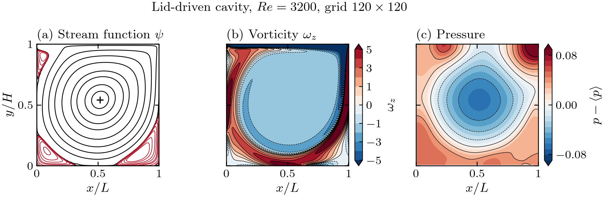
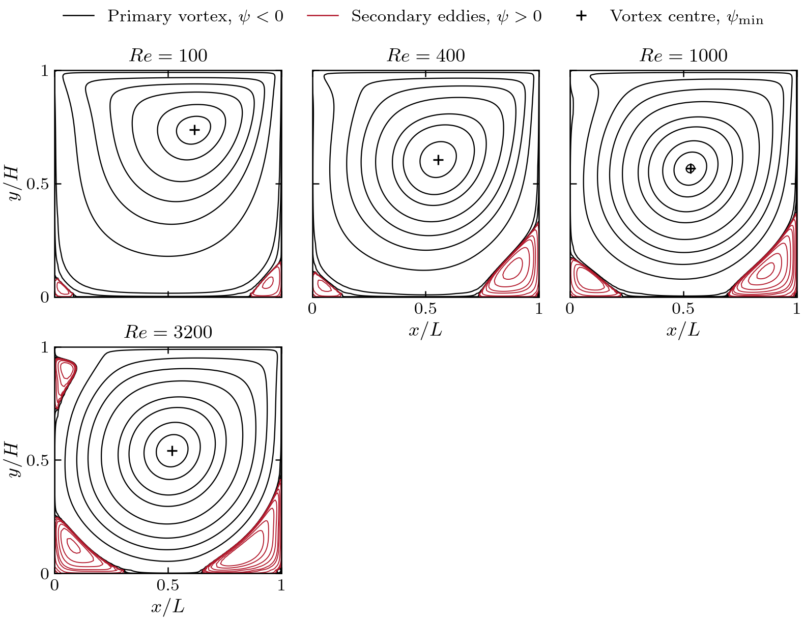
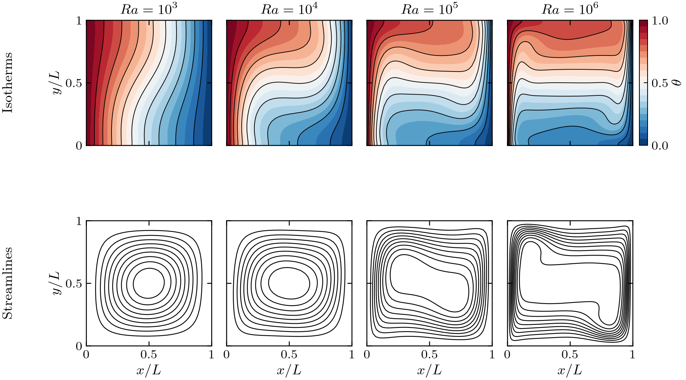
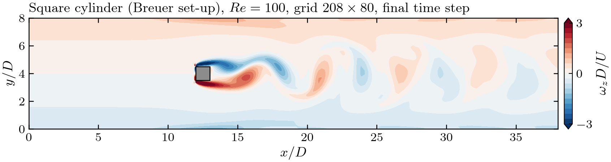

# NavierStokesSolver

A 2D incompressible Navier–Stokes solver written from scratch in C++17:
finite volumes on a **staggered (MAC) grid**, **fractional-step (projection)
method** with an explicit Adams–Bashforth 2 predictor and a Conjugate
Gradient pressure solver. Three classic problems are set up and validated
against their literature benchmarks.



**Documentation: [docs/README.md](docs/README.md)** — index of every page
(theory, boundary conditions, each scenario, input and output reference,
code map).

---

## Scenarios

| # | Scenario | Physics | Reference | Agreement | Page |
|---|---|---|---|---|---|
| 1 | Lid-driven cavity | flow driven by a sliding lid | Ghia, Ghia & Shin (1982) | $\psi_{\min}$ within 0.05 / 0.3 / 0.2 / 2.5 % at $Re$ = 100 / 400 / 1000 / 3200 | [docs/scenarios/lid_driven_cavity.md](docs/scenarios/lid_driven_cavity.md) |
| 2 | Differentially heated cavity | natural convection, Boussinesq buoyancy + energy equation | de Vahl Davis (1983) | $\overline{Nu}$ within 1.2 / 2.2 / 4.5 / 2.9 % at $Ra$ = $10^3$ / $10^4$ / $10^5$ / $10^6$ | [docs/scenarios/differentially_heated_cavity.md](docs/scenarios/differentially_heated_cavity.md) |
| 3 | Square cylinder in a channel | immersed obstacle, steady wake and vortex shedding | Breuer et al. (2000) | $C_D$ within 0.5 %, $L_r$ −0.4 % at $Re = 40$; onset between $Re$ = 50 and 70 (ref. ≈ 60); $St$ +1.4 % at $Re = 100$ | [docs/scenarios/square_cylinder.md](docs/scenarios/square_cylinder.md) |
| — | Discrete operators | Method of Manufactured Solutions | — | 2nd order on uniform grids; discrete identities to machine precision | [docs/reference/operators_verification.md](docs/reference/operators_verification.md) |

Each scenario page documents the physical problem, the equations, the
boundary and initial conditions, the numerical set-up, the code path, how to
run it, its outputs and its validation results, in that order.

<p>

</p>
<p>

</p>
<p>

</p>

## Quick start

```bash
# Build (CMake >= 3.15, C++17; OpenMP optional)
bash run.sh build

# Run one case in an isolated copy of input/, store it in output/
tools/run_case.sh lid_driven_cavity 1000 --set ss_tol=1e-5 --threads 1

# Plot (Python env: python3 -m venv .venv && .venv/bin/pip install -r requirements.txt)
.venv/bin/python3 plotters/plot_results.py
```

Or select the scenario in `input/scenario.txt` and run `bash run.sh`. The
commands that reproduce every validated result are in
[docs/getting_started.md §7](docs/getting_started.md#7-reproducing-the-validated-results).
Run everything from the repository root.

## Method in brief

- **Grid:** staggered MAC grid — $p$ and $\theta$ at cell centres, $u$ and
  $v$ on the cell faces — with `sinh` stretching in up to 3×3 zones
  ([docs/theory/mesh.md](docs/theory/mesh.md)).
- **Time step:** predictor (AB2, central-difference convection) →
  pressure Poisson equation (warm-started CG / Jacobi-PCG) → projection to a
  divergence-free field ([docs/theory/equations.md](docs/theory/equations.md),
  [docs/theory/solver.md](docs/theory/solver.md)).
- **Boundary conditions:** no-slip and moving walls, uniform and parabolic
  inlets, zero-gradient outlet with Dirichlet pressure, isothermal and
  adiabatic walls, and an immersed rectangular obstacle, all through the
  ghost-cell image method ([docs/theory/boundary_conditions.md](docs/theory/boundary_conditions.md)).
- **Modular extensions:** the energy equation and buoyancy, and the immersed
  obstacle, were added without changing the momentum/pressure core.
- **Post-processing:** VTK fields for ParaView; Python plotters with exact
  discrete stream function and vorticity on the MAC grid, benchmark overlays
  and validation tables; figures as vector PDF (LaTeX-ready) and PNG
  ([docs/outputs.md](docs/outputs.md)).

## Repository layout

```
.
├── src/                    C++ solver (code map: docs/reference/code_map.md)
│   ├── main.cpp                driver: scenario → mesh → time loop → output
│   ├── MomentumSolver.*        predictor + velocity boundary conditions
│   ├── PressurePoissonSystem.* pressure equation + projection
│   ├── EnergySolver.*, Buoyancy.hpp   energy equation, Boussinesq coupling (scenario 2)
│   ├── mesh/                   grid generation, boundary conditions, obstacle helpers
│   ├── operators/              Laplacian, gradient, divergence, diffusion
│   ├── solver/sparse/          CSR matrix, CG / PCG and other linear solvers
│   ├── postprocessing/         drag, lift, Strouhal number (scenario 3)
│   └── verification/           MMS operator tests (operator_verify)
├── input/                  scenario.txt + one folder per scenario (docs/input_reference.md)
├── output/                 results per scenario and case (docs/outputs.md)
├── plotters/               Python post-processing
├── tools/                  run_case.sh, run_pending_cases.sh, status.sh
├── docs/                   documentation (start at docs/README.md)
├── CMakeLists.txt
└── run.sh                  configure + build + run helper
```

## Limitations and future work

- Fully explicit time stepping: the time step is limited by
  $h_{\min}^2/(8\nu)$, which is restrictive for the heated cavity and for
  fine grids. Implicit diffusion would remove it.
- The pressure Laplacian is first-order accurate on stretched grids.
- `SYMMETRY` (slip) walls are not implemented yet, which blocks the
  unconfined cylinder benchmark of Sohankar et al. (1998).
- Further ideas: incremental pressure correction, a stronger pressure
  preconditioner, command-line case selection, RANS/URANS turbulence
  modelling ([docs/theory/solver.md §8](docs/theory/solver.md#8-possible-extension-turbulence-modelling-rans--les)).

Details per scenario are in the "Known limitations" section of each scenario
page.

## License

[MIT](LICENSE)
