# NavierStokesSolver

A 2D incompressible Navier–Stokes solver built from scratch in C++17, using a
**staggered (MAC) grid** and the **fractional-step (projection) method**.
Three scenarios, each validated against a classic CFD benchmark: the
Lid-Driven Cavity (Ghia et al. 1982), the Differentially Heated Cavity
(de Vahl Davis 1983) and the Square Cylinder in a channel (Breuer et al.
2000) — see the scenario docs for exact status.

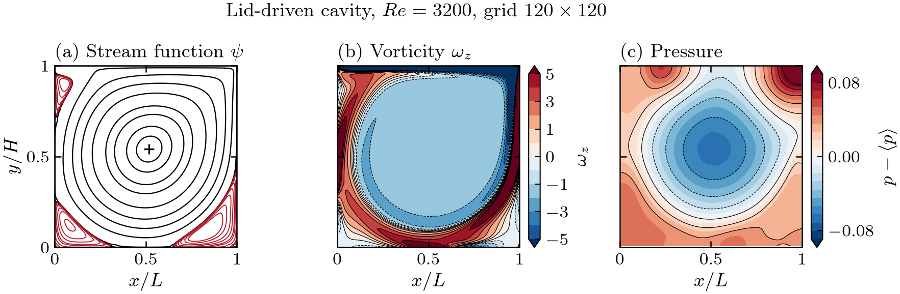

## Features

- **Staggered MAC grid** with independent per-side mesh stretching
  (`sinh`-based refinement) for resolving boundary layers.
- **Fractional-step / projection method** (Chorin): explicit momentum
  predictor + pressure-Poisson correction, enforcing incompressibility
  exactly every step.
- **Warm-started Conjugate Gradient** pressure solver on a symmetric
  positive-definite system assembled via finite volumes.
- **Modular discrete operators** (gradient, divergence, Laplacian,
  diffusion), each independently verified via the Method of Manufactured
  Solutions, with automated convergence-rate reporting.
- **Three physical scenarios**, selectable via `input/scenario.txt`:
  - **Lid-Driven Cavity** — momentum + pressure only. Validated.
  - **Differentially Heated Cavity** — adds an energy equation and
    Boussinesq buoyancy coupling on top of the same core solver, with zero
    modifications to the momentum/pressure code. Validated.
  - **Square Cylinder** — an immersed solid obstacle in a channel
    (inlet/outlet), with drag/lift/Strouhal post-processing. Validated
    against Breuer et al. (2000) in the steady and periodic regimes.
- **Batch sweeps** over Reynolds or Rayleigh numbers in a single run.
- **VTK export** (rectilinear grid) for direct visualization in ParaView.
- **Python post-processing** with a shared LaTeX (Computer Modern) figure
  style: exact discrete stream function / vorticity on the MAC grid,
  benchmark overlays, and validation tables. Every figure is written as a
  vector PDF (for LaTeX documents) and a 300 dpi PNG.

## Project structure

```
.
├── src/                    # C++ solver source
│   ├── mesh/                   mesh generation, stretching, boundary setup,
│   │                           ObstacleMask.hpp (immersed-obstacle helpers)
│   ├── operators/               gradient / divergence / Laplacian / diffusion
│   ├── solver/sparse/           CSR matrix + CG/PCG/GS/SOR linear solvers
│   ├── postprocessing/           drag/lift/Strouhal (Square Cylinder scenario)
│   ├── verification/            MMS-based operator convergence checks
│   ├── MomentumSolver.*         predictor step (momentum)
│   ├── PressurePoissonSystem.*  pressure projection step
│   ├── EnergySolver.*           energy equation (DHC scenario only)
│   ├── Buoyancy.hpp             Boussinesq coupling (DHC scenario only)
│   └── main.cpp                 driver: mesh → time loop → VTK/CSV output
├── input/
│   ├── scenario.txt             selects the active scenario
│   ├── lid_driven_cavity/        per-scenario config (geometry, BCs, params)
│   ├── differentially_heated_cavity/
│   └── square_cylinder/
├── output/                 # Simulation results, per scenario and case (see "Output layout")
├── plotters/               # Python post-processing; nsplot.py = shared style + I/O
├── docs/
│   ├── theory/                  equations, mesh, solver — how it works
│   ├── scenarios/               one page per physical problem — how to run it
│   └── figures/                 curated result figures shown in this README
├── CMakeLists.txt
└── run.sh                  # configure + build + run helper
```

## Requirements

- CMake ≥ 3.15
- A C++17 compiler (g++/clang++)
- Python 3 with `numpy`, `pandas`, `matplotlib`, `scipy` (for the plotting
  scripts in `plotters/`) — see the venv setup below.

## Python environment (for the plotting scripts)

The repo includes a `requirements.txt` pinning the packages the plotters in
`plotters/` need. Set up a dedicated virtual environment once:

```bash
python3 -m venv .venv
.venv/bin/pip install -r requirements.txt
```

`.vscode/settings.json` already points VSCode's Python extension at
`.venv/bin/python3`, so opening any `plotters/*.py` file and running it
(▷ button, "Run Python File", or the integrated terminal) uses the right
interpreter automatically — no need to select one manually. If your system's
default `python3` happens to resolve to some other environment (e.g. a
different project's venv) that's missing these packages, explicitly call
`.venv/bin/python3 plotters/plot_results.py` instead.

## Build & run

```bash
bash run.sh              # configure, build, and run the main solver
bash run.sh build        # configure + build only (all 3 executables)
bash run.sh mesh_gen     # main solver: scenario picked by input/scenario.txt
bash run.sh verify       # operator_verify: MMS convergence check for the operators
bash run.sh sweep        # reynolds_sweep: batch sweep over the active scenario's reynolds_cases.txt
```

Or manually:
```bash
cmake -S . -B build_cmake -DCMAKE_BUILD_TYPE=Release
cmake --build build_cmake
./build/mesh_gen          # or operator_verify / reynolds_sweep
```

All three executables must be run **from the repository root**, since
`input/` and `output/` are resolved as relative paths.

### Running individual cases

`tools/run_case.sh` runs one case in an isolated copy of `input/` (the
committed files are never edited), with optional overrides, and stores the
result with the exact inputs used:

```bash
tools/run_case.sh square_cylinder_breuer 100 --set max_steps=50000 --threads 4
tools/run_case.sh square_cylinder_breuer 100 --scale 1.25 --store grid_study/D20
tools/run_case.sh lid_driven_cavity 1000 --set dt=1e-3 --set ss_tol=1e-5 --threads 1
```

→ `output/<scenario>[/<store>]/Re_<N>/{fields,data,input}/`, with the solver
log in `data/run.log`. Several cases can run at once. A case that diverges
writes nothing and reports `FAILED`. `tools/run_pending_cases.sh` runs every
case still missing from `output/` and regenerates the figures.

## Results

All figures below are produced by the scripts in `plotters/` from the data
in `output/`; the numbers in the tables are read from each scenario's
`validation_summary.csv`.

### 1. Lid-Driven Cavity

```bash
# input/scenario.txt: scenario = lid_driven_cavity
bash run.sh mesh_gen
python3 plotters/plot_results.py
```

Stream function, drawn with the contour levels of Ghia et al. (1982), for the
resolved runs (120×120 stretched grid, $Re = 100$–$3200$). The primary vortex
moves towards the cavity centre and the corner eddies (red, $\psi > 0$) grow
with $Re$; the top-left eddy appears at $Re = 3200$.

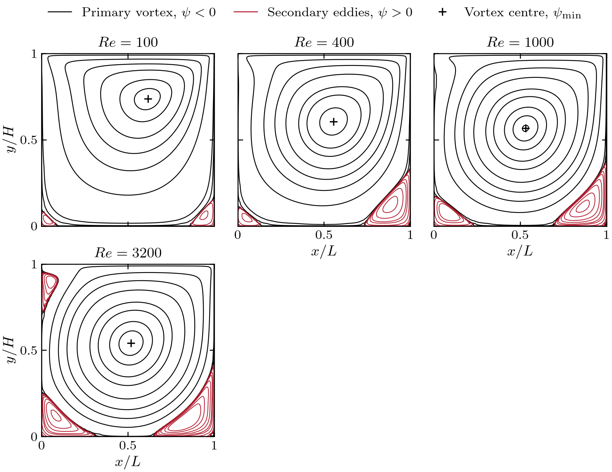

Centreline velocity profiles against Ghia et al. (1982) (lines: present;
symbols: reference):

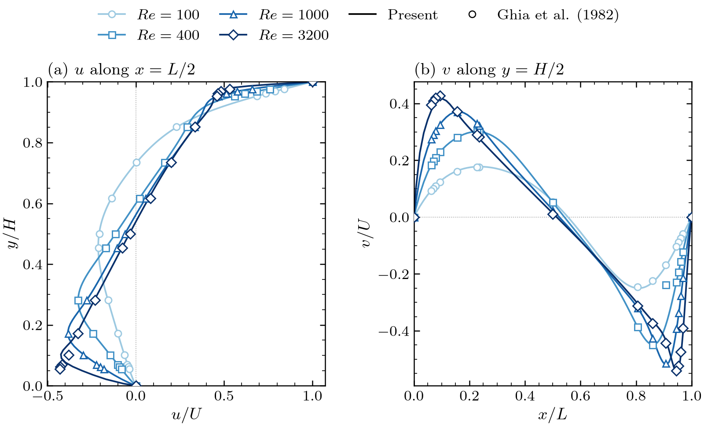

| $Re$ | Grid | $\psi_{\min}$ | Ghia | Error | Vortex centre | Ghia | RMS $\Delta u$ | RMS $\Delta v$ |
|---|---|---|---|---|---|---|---|---|
| 100 | 120×120 | −0.1035 | −0.1034 | 0.05 % | (0.616, 0.737) | (0.617, 0.734) | 0.0015 | 0.0028 |
| 400 | 120×120 | −0.1136 | −0.1139 | 0.30 % | (0.554, 0.606) | (0.555, 0.606) | 0.0009 | 0.037 † |
| 1000 | 120×120 | −0.1177 | −0.1179 | 0.22 % | (0.531, 0.566) | (0.531, 0.563) | 0.0028 | 0.0027 |
| 3200 | 120×120 | −0.1173 | −0.1204 | 2.5 % | (0.518, 0.541) | (0.517, 0.547) | 0.0385 | 0.0120 |

The stream-function minimum agrees with Ghia to 0.05–0.3 % up to $Re = 1000$
and 2.5 % at $Re = 3200$.

† The Re = 400 $v$ error is dominated by a single reference point,
$x/L = 0.9063$: the embedded table (`input/lid_driven_cavity/ghia_reference.txt`
and `plotters/plot_results.py`) gives $-0.23827$, but the present solution
($-0.3816$) agrees with the other 14 points of that column to 0.001, and the
tabulated value breaks the monotonic trend of its own column
($-0.228,\,-0.238,\,-0.450$). It looks like a transcription error in the
reference data; **it should be checked against the original paper** (Table II)
before the Re = 400 $v$ error is quoted.

$Re = 5000$ and $7500$ are being re-run on the same 120×120 grid; the 50×50
results currently stored for them are under-resolved and are left out of the
figures above. The intermediate $Re = 200$–$900$ runs are on 40×40 and are
only used for the trend in the per-case folders. See
[docs/scenarios/lid_driven_cavity.md](docs/scenarios/lid_driven_cavity.md).

### 2. Differentially Heated Cavity

```bash
# input/scenario.txt: scenario = differentially_heated_cavity
bash run.sh mesh_gen
python3 plotters/plot_dhc.py
```

Isotherms and streamlines for $Pr = 0.71$ (hot wall left, cold wall right).
As $Ra$ grows, conduction gives way to thin thermal boundary layers and a
stratified core.

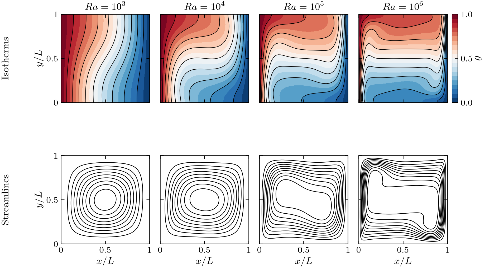

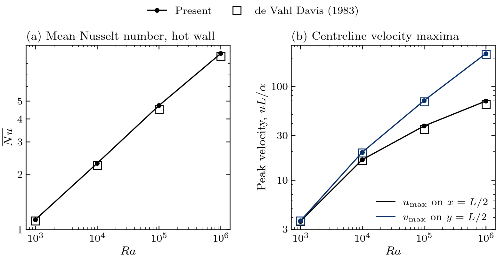

| $Ra$ | Grid | $\overline{Nu}$ | de Vahl Davis | Error | $u_{\max}$ (present / ref.) | $v_{\max}$ (present / ref.) |
|---|---|---|---|---|---|---|
| $10^3$ | 40×40 | 1.131 | 1.118 | 1.2 % | 3.64 / 3.65 | 3.68 / 3.70 |
| $10^4$ | 40×40 | 2.292 | 2.243 | 2.2 % | 16.51 / 16.18 | 19.82 / 19.62 |
| $10^5$ | 40×40 | 4.722 | 4.519 | 4.5 % | 37.78 / 34.73 | 70.52 / 68.59 |
| $10^6$ | 100×100 | 9.059 | 8.800 | 2.9 % | 69.65 / 64.63 | 223.76 / 219.36 |

$Ra = 10^3$–$10^5$ were computed on a uniform 40×40 grid with `dt = 2e-5`;
$Ra = 10^6$ on a uniform 100×100 grid with `dt = 2.5e-6`, run to $t = 0.4$
(diffusive units; residual $\lVert\Delta u\rVert_\infty/\Delta t \approx 0.02$
against velocities of order 200). The shipped
`input/differentially_heated_cavity/` uses a finer 120×120 stretched grid and
`dt = 1e-5`, which is impractical at $Ra = 10^6$ with the explicit scheme
($\Delta t \sim 10^{-7}$ would be needed). The 8 % error in $u_{\max}$ at
$Ra = 10^6$ is the largest in the table; it shrinks with a finer grid
(not yet done). **Note the explicit-scheme stability caveat** in
[docs/scenarios/differentially_heated_cavity.md](docs/scenarios/differentially_heated_cavity.md)
before choosing a time step.

### 3. Square Cylinder

Validated against the confined-cylinder benchmark of Breuer et al. (2000):
blockage $D/H = 1/8$, parabolic inflow, $Re = U_{\max}D/\nu$, channel length
$50D$. The benchmark set-up is its own scenario:

```bash
# input/scenario.txt: scenario = square_cylinder_breuer
bash run.sh mesh_gen
python3 plotters/plot_square_cylinder.py square_cylinder_breuer
```

**Steady regime.** Recirculation behind the cylinder at $Re = 40$, and its
length over the whole steady range against Breuer's fit:

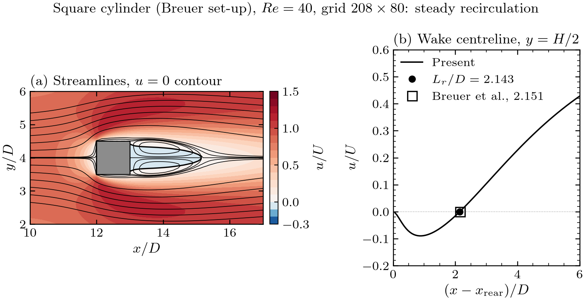

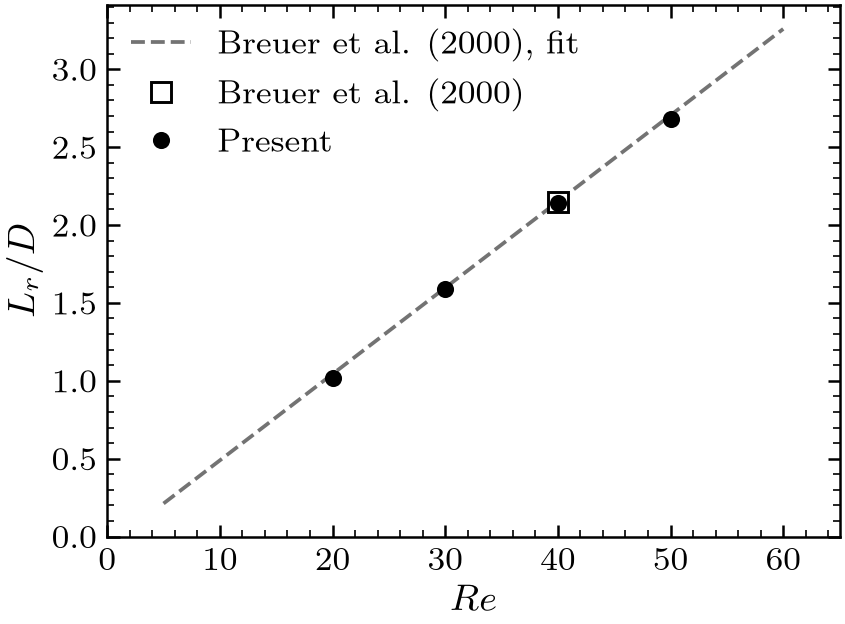

| $Re$ | $C_D$ | Breuer | $L_r/D$ | Breuer |
|---|---|---|---|---|
| 20 | 2.366 | — | 1.017 | 1.043 (fit) |
| 30 | 1.944 | — | 1.586 | 1.597 (fit) |
| 40 | **1.716** | **1.708** | **2.143** | **2.151** |
| 50 | 1.571 | — | 2.681 | 2.705 (fit) |

Grid study at $Re = 40$ ($D/12$, $D/16$, $D/20$ cells across the cylinder):
$C_D = 1.718$, $1.716$, $1.717$ and $L_r/D = 2.132$, $2.143$, $2.150$, so the
drag is grid-independent to 0.1 % and the recirculation length converges onto
the reference.

**Onset and shedding.** The flow is steady at $Re = 50$ (lift perturbation at
round-off level) and shedding develops at $Re = 70$, bracketing Breuer's
$Re_{cr} \approx 60$. At $Re = 100$ periodic shedding settles from
$tU/D \approx 190$ (run to $tU/D = 400$, ≈ 30 saturated periods):

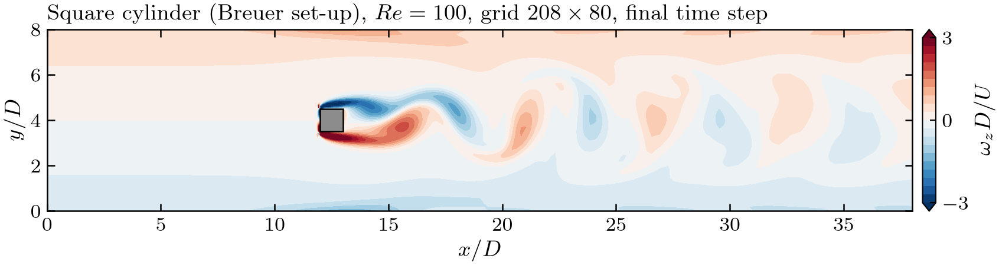

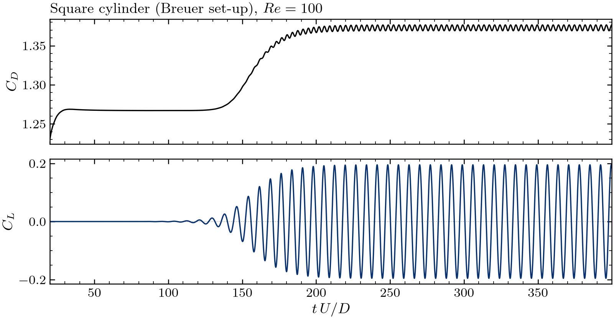

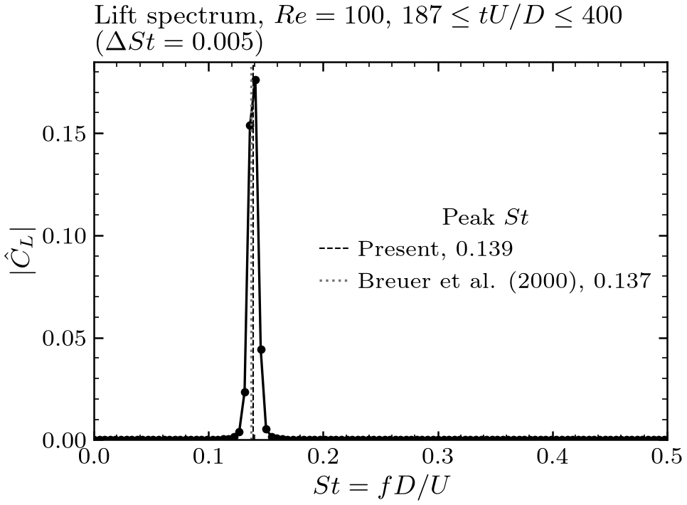

| $Re$ | $St$ (FFT of $C_L$) | $St$ (zero crossings) | $\overline{C_D}$ | $C_{L,\mathrm{rms}}$ | Breuer, $St$ |
|---|---|---|---|---|---|
| 70 | 0.1260 | 0.1260 | 1.437 | 0.070 | — |
| 100 | **0.1389** | 0.1389 | 1.372 | 0.138 | **0.137** |
| 100, $D/20$ grid | 0.1391 | 0.1391 | 1.359 | 0.137 | |
| 150 | 0.1486 | 0.1487 | 1.355 | 0.226 | — |
| 200 | 0.1474 | 0.1475 | 1.386 | 0.360 | — |

At $Re = 100$ the Strouhal number is 1.4 % above the reference and
independent of the grid to 0.2 % ($D/16$ → $D/20$). The values at
$Re = 70, 150, 200$ are predictions of the present solver: Breuer et al.
give their $St(Re)$ curve only graphically, so no reference is plotted for
them. $St$ rises up to $Re \approx 150$ and flattens beyond.

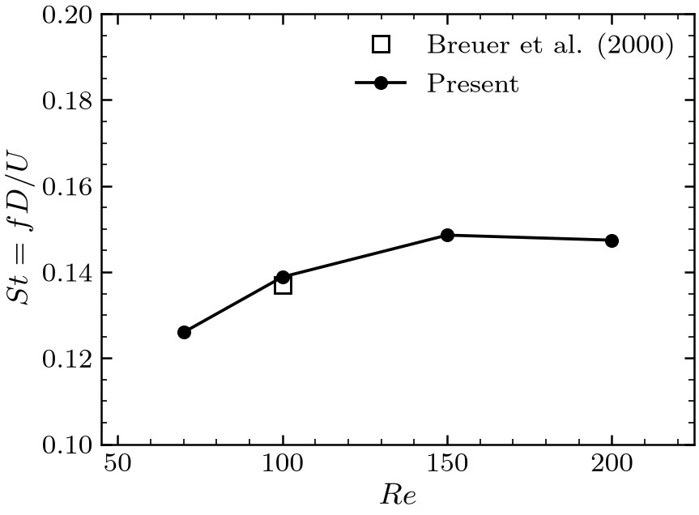

Reaching this required four solver fixes (swapped viscous force components,
obstacle-surface flux leaking into the pressure equation, inverted wall
distances at the obstacle, and a NaN mistaken for convergence); **cylinder
results computed before them are invalid**. Details, the references and the
remaining work (unconfined benchmark of Sohankar et al. 1998, which needs
slip side walls) are in
[docs/scenarios/square_cylinder_validation.md](docs/scenarios/square_cylinder_validation.md).

The shipped `square_cylinder` scenario (uniform inflow between no-slip walls)
runs the same solver but matches no published benchmark; run it with
`python3 plotters/plot_square_cylinder.py`.

### 4. Operator verification / convergence rates

```bash
bash run.sh verify
python3 plotters/plot_convergence.py
```
Second-order accuracy of every discrete operator on a uniform mesh (observed
order $p$ in the legends), first order for the Laplacian on a stretched mesh
(see [docs/theory/solver.md](docs/theory/solver.md)), and machine-precision
residuals for the discrete identities.

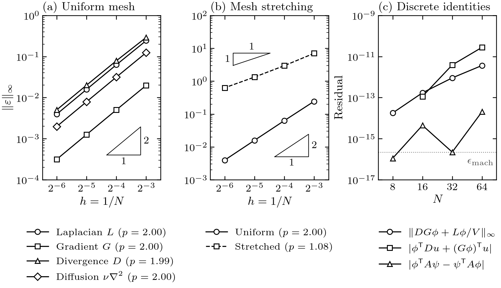

## Output layout

Results are classified by scenario, then by case:

```
output/
├── lid_driven_cavity/
│   ├── mesh/                    mesh_P.vtk, mesh_U.vtk, mesh_V.vtk
│   ├── Re_<N>/
│   │   ├── fields/              pressure.vtk, u_velocity.vtk, v_velocity.vtk  (ParaView)
│   │   ├── data/                centerline_u.csv, centerline_v.csv
│   │   └── figures/             flow_fields.{pdf,png}, centerlines.{pdf,png}
│   ├── figures/                 cross-case figures (profiles, stream-function overview)
│   └── validation_summary.csv   errors vs. Ghia et al. (1982)
├── differentially_heated_cavity/
│   ├── mesh/
│   ├── Ra_<N>/{fields,data,figures}/   + temperature.vtk, dhc_metrics.csv
│   ├── figures/                 fields overview, Nu / velocity benchmark
│   └── validation_summary.csv   errors vs. de Vahl Davis (1983)
├── square_cylinder/  (and square_cylinder_breuer/, the validation set-up)
│   ├── mesh/                    + obstacle_mask.vtk
│   ├── Re_<N>/{fields,data,figures}/   + forces.csv, strouhal.csv;
│   │                            vorticity, force_coefficients, lift_spectrum
│   ├── figures/                 Strouhal vs. Re, recirculation length vs. Re
│   └── force_summary.csv        C_D, C_L, St, L_r and reference values per case
└── verification/
    ├── data/convergence.csv
    └── figures/convergence_rates.{pdf,png}
```

The solver writes `mesh/`, `fields/` and `data/`; the plotters write
`figures/` and the summary CSVs. `figures/` folders are git-ignored because
they are regenerated on demand; the figures shown in this README are kept in
[docs/figures/](docs/figures/). For a LaTeX document, include the `.pdf`
versions directly: figures are drawn at a 6.3 in text width with 9 pt
Computer Modern, so they match the body text without rescaling.

## Input file reference

`input/scenario.txt` selects the active scenario
(`lid_driven_cavity` / `differentially_heated_cavity` / `square_cylinder` /
`square_cylinder_breuer`);
everything else lives in that scenario's own subfolder,
`input/<scenario>/`, as plain text:

| File | Controls |
|---|---|
| `data.txt` | Domain geometry: `L_domain`, `H_domain`, depth, zone corner nodes |
| `stretch.txt` | Cell counts per zone and stretching factors (`beta_*`) |
| `sim_params.txt` | `dt`, `rho`, `U_lid`/`U_inf`, `max_steps`, `ss_tol`, `solve_energy`, `Pr` |
| `boundaries.txt` | Velocity boundary conditions (`WALL`, `WALL_FIXED_VALUE`, `INLET`, `INLET_PARABOLIC` with $U_{\max}$, `OUTLET`) |
| `boundaries_T.txt` | Temperature boundary conditions (DHC only) |
| `obstacle.txt` | Solid obstacle bounds (Square Cylinder only) |
| `reynolds_cases.txt` | Reynolds numbers to sweep (Lid-Driven Cavity / Square Cylinder) |
| `rayleigh_cases.txt` | Rayleigh numbers to sweep (Differentially Heated Cavity) |

## Documentation

**Theory** — the physics and numerics, independent of any one scenario:
- [docs/theory/equations.md](docs/theory/equations.md) — governing equations and the fractional-step method
- [docs/theory/mesh.md](docs/theory/mesh.md) — the staggered grid, stretching, boundary setup
- [docs/theory/solver.md](docs/theory/solver.md) — the solver pipeline, class by class

**Scenarios** — the physical problems and how to run them:
- [docs/scenarios/lid_driven_cavity.md](docs/scenarios/lid_driven_cavity.md)
- [docs/scenarios/differentially_heated_cavity.md](docs/scenarios/differentially_heated_cavity.md) (+ [full implementation deep-dive](docs/scenarios/differentially_heated_cavity_EN.md))
- [docs/scenarios/square_cylinder.md](docs/scenarios/square_cylinder.md) — validated against Breuer et al. (2000) (+ [references, fixes and validation results](docs/scenarios/square_cylinder_validation.md))

**Legacy** (Spanish, detailed derivations from early development):
[docs/ALGORITMO.md](docs/ALGORITMO.md), [docs/OPERATORS_REPORT.md](docs/OPERATORS_REPORT.md),
[docs/differentially_heated_cavity.md](docs/differentially_heated_cavity.md).

## Validation summary

| Scenario | Reference | Agreement |
|---|---|---|
| Lid-Driven Cavity | Ghia, Ghia & Shin (1982), $Re=100$–$10000$ | $\psi_{\min}$ within 0.05 / 0.3 / 0.2 / 2.5 % at $Re = 100$ / 400 / 1000 / 3200 (120×120); $Re = 5000, 7500$ re-run pending |
| Differentially Heated Cavity | de Vahl Davis (1983), $Ra=10^3$–$10^6$ | $\overline{Nu}$ within 1.2 / 2.2 / 4.5 / 2.9 % at $Ra=10^3$ / $10^4$ / $10^5$ (40²) / $10^6$ (100²) |
| Square Cylinder | Breuer et al. (2000), $\beta = 1/8$ | $C_D$ +0.5 %, $L_r$ −0.4 % at $Re = 40$ (grid-converged); $Re_{cr}$ between 50 and 70 (ref. ≈ 60); $St$ +1.4 % at $Re = 100$ (grid-converged). Unconfined benchmark (Sohankar 1998) pending — see [validation](docs/scenarios/square_cylinder_validation.md) |
| Discrete operators | Method of Manufactured Solutions | ~2nd-order convergence on uniform meshes |

## Future improvements (not yet implemented)

- CLI arguments / a config file selector, instead of hand-editing `input/*.txt` between runs.
- Second-order-accurate Laplacian stencil on stretched meshes (currently 1st-order — see [docs/theory/mesh.md](docs/theory/mesh.md)).
- Square Cylinder: real slip side walls for the unconfined Sohankar et al. (1998) benchmark, an incremental pressure-correction scheme, and a stronger preconditioner for the pressure solver — see [docs/scenarios/square_cylinder_validation.md](docs/scenarios/square_cylinder_validation.md).

## License

[MIT](LICENSE)
