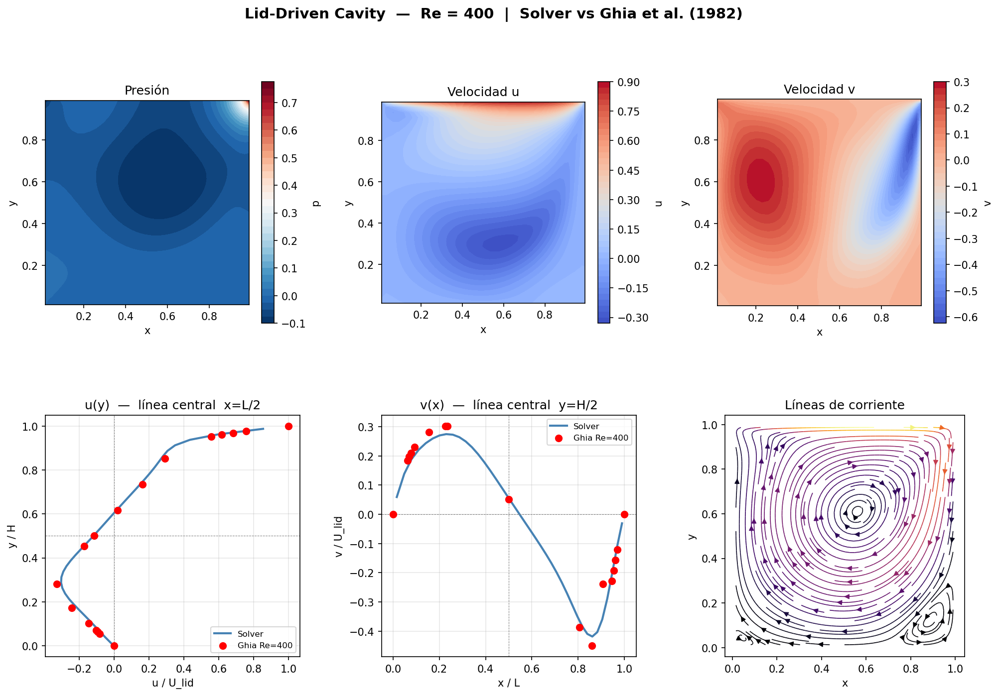
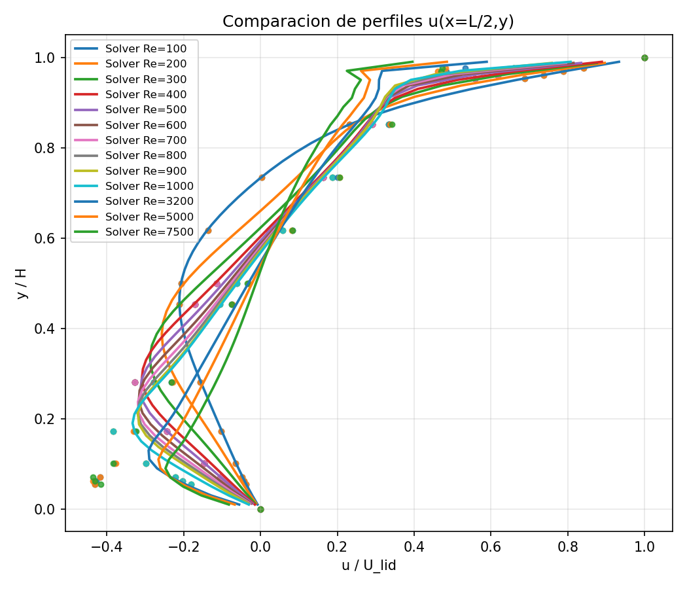
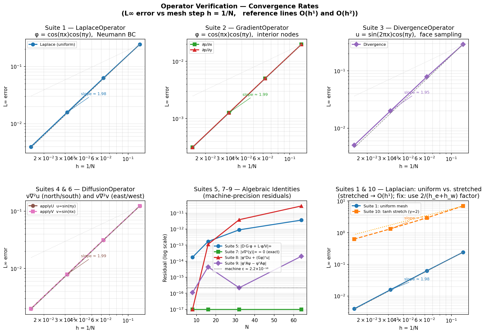

# NavierStokesSolver

A 2D incompressible Navier–Stokes solver built from scratch in C++17, using a
**staggered (MAC) grid** and the **fractional-step (projection) method**.
Three scenarios: the Lid-Driven Cavity and Differentially Heated Cavity are
validated against classic CFD benchmarks (Ghia et al. 1982, de Vahl Davis
1983); a Square Cylinder scenario (immersed obstacle, vortex shedding,
drag/lift/Strouhal) runs end to end but is not yet calibrated against
literature — see the scenario docs for exact status.



## Features

- **Staggered MAC grid** with independent per-side mesh stretching
  (`sinh`-based refinement) for resolving boundary layers.
- **Fractional-step / projection method** (Chorin): explicit momentum
  predictor + pressure-Poisson correction, enforcing incompressibility
  exactly every step.
- **Warm-started Conjugate Gradient** pressure solver on a symmetric
  positive-definite system assembled via finite volumes.
- **Modular discrete operators** (gradient, divergence, Laplacian,
  diffusion), each independently verified via the Method of Manufactured
  Solutions, with automated convergence-rate reporting.
- **Three physical scenarios**, selectable via `input/scenario.txt`:
  - **Lid-Driven Cavity** — momentum + pressure only. Validated.
  - **Differentially Heated Cavity** — adds an energy equation and
    Boussinesq buoyancy coupling on top of the same core solver, with zero
    modifications to the momentum/pressure code. Validated.
  - **Square Cylinder** — an immersed solid obstacle in an open channel
    (inlet/outlet), with drag/lift/Strouhal post-processing. Runs end to end
    without NaN/divergence; Strouhal-number agreement with literature is not
    yet calibrated.
- **Batch sweeps** over Reynolds or Rayleigh numbers in a single run.
- **VTK export** (rectilinear grid) for direct visualization in ParaView.
- **Python post-processing**: centerline-profile validation against
  reference data, Nusselt-number/temperature-field plots, vorticity +
  drag/lift/Strouhal plots, and operator convergence-rate plots.

## Project structure

```
.
├── src/                    # C++ solver source
│   ├── mesh/                   mesh generation, stretching, boundary setup,
│   │                           ObstacleMask.hpp (immersed-obstacle helpers)
│   ├── operators/               gradient / divergence / Laplacian / diffusion
│   ├── solver/sparse/           CSR matrix + CG/PCG/GS/SOR linear solvers
│   ├── postprocessing/           drag/lift/Strouhal (Square Cylinder scenario)
│   ├── verification/            MMS-based operator convergence checks
│   ├── MomentumSolver.*         predictor step (momentum)
│   ├── PressurePoissonSystem.*  pressure projection step
│   ├── EnergySolver.*           energy equation (DHC scenario only)
│   ├── Buoyancy.hpp             Boussinesq coupling (DHC scenario only)
│   └── main.cpp                 driver: mesh → time loop → VTK/CSV output
├── input/
│   ├── scenario.txt             selects the active scenario
│   ├── lid_driven_cavity/        per-scenario config (geometry, BCs, params)
│   ├── differentially_heated_cavity/
│   └── square_cylinder/
├── output/                 # Simulation results (VTK, CSV, PNG), per case
├── plotters/               # Python post-processing / validation scripts
├── docs/
│   ├── theory/                  equations, mesh, solver — how it works
│   └── scenarios/               one page per physical problem — how to run it
├── CMakeLists.txt
└── run.sh                  # configure + build + run helper
```

## Requirements

- CMake ≥ 3.15
- A C++17 compiler (g++/clang++)
- Python 3 with `numpy`, `pandas`, `matplotlib`, `scipy` (for the plotting
  scripts in `plotters/`) — see the venv setup below.

## Python environment (for the plotting scripts)

The repo includes a `requirements.txt` pinning the packages the plotters in
`plotters/` need. Set up a dedicated virtual environment once:

```bash
python3 -m venv .venv
.venv/bin/pip install -r requirements.txt
```

`.vscode/settings.json` already points VSCode's Python extension at
`.venv/bin/python3`, so opening any `plotters/*.py` file and running it
(▷ button, "Run Python File", or the integrated terminal) uses the right
interpreter automatically — no need to select one manually. If your system's
default `python3` happens to resolve to some other environment (e.g. a
different project's venv) that's missing these packages, explicitly call
`.venv/bin/python3 plotters/plot_results.py` instead.

## Build & run

```bash
bash run.sh              # configure, build, and run the main solver
bash run.sh build        # configure + build only (all 3 executables)
bash run.sh mesh_gen     # main solver: scenario picked by input/scenario.txt
bash run.sh verify       # operator_verify: MMS convergence check for the operators
bash run.sh sweep        # reynolds_sweep: batch sweep over the active scenario's reynolds_cases.txt
```

Or manually:
```bash
cmake -S . -B build_cmake -DCMAKE_BUILD_TYPE=Release
cmake --build build_cmake
./build/mesh_gen          # or operator_verify / reynolds_sweep
```

All three executables must be run **from the repository root**, since
`input/` and `output/` are resolved as relative paths.

## Examples

### 1. Lid-Driven Cavity

```bash
# input/scenario.txt: scenario = lid_driven_cavity
bash run.sh mesh_gen
python3 plotters/plot_results.py
```
Validated against Ghia et al. (1982) at $Re = 100$–$10000$. See
[docs/scenarios/lid_driven_cavity.md](docs/scenarios/lid_driven_cavity.md).



### 2. Differentially Heated Cavity

```bash
# input/scenario.txt: scenario = differentially_heated_cavity
bash run.sh mesh_gen
python3 plotters/plot_dhc.py
```
Validated against de Vahl Davis (1983): $\overline{Nu}\approx 2.31$ at
$Ra=10^4$, matching the reference value (2.243) within a few percent. See
[docs/scenarios/differentially_heated_cavity.md](docs/scenarios/differentially_heated_cavity.md)
— **note the explicit-scheme stability caveat** there before picking a time
step.

### 3. Square Cylinder

```bash
# input/scenario.txt: scenario = square_cylinder
bash run.sh mesh_gen
python3 plotters/plot_square_cylinder.py
```
Immersed solid obstacle in an open channel, inlet/outlet flow, drag/lift
recorded every step, provisional Strouhal estimate. **Runs clean, but the
Strouhal number is not yet calibrated against literature (~0.13–0.15 at
Re~100–200)** — see
[docs/scenarios/square_cylinder.md](docs/scenarios/square_cylinder.md) for
exactly what has and hasn't been checked.

### 4. Operator verification / convergence rates

```bash
bash run.sh verify
python3 plotters/plot_convergence.py
```
Produces `output/convergence_rates.png`, confirming 2nd-order accuracy of
the discrete operators on a uniform mesh (see
[docs/theory/solver.md](docs/theory/solver.md) for a documented caveat on
stretched-mesh accuracy).



## Input file reference

`input/scenario.txt` selects the active scenario
(`lid_driven_cavity` / `differentially_heated_cavity` / `square_cylinder`);
everything else lives in that scenario's own subfolder,
`input/<scenario>/`, as plain text:

| File | Controls |
|---|---|
| `data.txt` | Domain geometry: `L_domain`, `H_domain`, depth, zone corner nodes |
| `stretch.txt` | Cell counts per zone and stretching factors (`beta_*`) |
| `sim_params.txt` | `dt`, `rho`, `U_lid`/`U_inf`, `max_steps`, `ss_tol`, `solve_energy`, `Pr` |
| `boundaries.txt` | Velocity boundary conditions |
| `boundaries_T.txt` | Temperature boundary conditions (DHC only) |
| `obstacle.txt` | Solid obstacle bounds (Square Cylinder only) |
| `reynolds_cases.txt` | Reynolds numbers to sweep (Lid-Driven Cavity / Square Cylinder) |
| `rayleigh_cases.txt` | Rayleigh numbers to sweep (Differentially Heated Cavity) |

## Documentation

**Theory** — the physics and numerics, independent of any one scenario:
- [docs/theory/equations.md](docs/theory/equations.md) — governing equations and the fractional-step method
- [docs/theory/mesh.md](docs/theory/mesh.md) — the staggered grid, stretching, boundary setup
- [docs/theory/solver.md](docs/theory/solver.md) — the solver pipeline, class by class

**Scenarios** — the physical problems and how to run them:
- [docs/scenarios/lid_driven_cavity.md](docs/scenarios/lid_driven_cavity.md)
- [docs/scenarios/differentially_heated_cavity.md](docs/scenarios/differentially_heated_cavity.md) (+ [full implementation deep-dive](docs/scenarios/differentially_heated_cavity_EN.md))
- [docs/scenarios/square_cylinder.md](docs/scenarios/square_cylinder.md) — **implemented, validation pending**

**Legacy** (Spanish, detailed derivations from early development):
[docs/ALGORITMO.md](docs/ALGORITMO.md), [docs/OPERATORS_REPORT.md](docs/OPERATORS_REPORT.md),
[docs/differentially_heated_cavity.md](docs/differentially_heated_cavity.md).

## Validation summary

| Scenario | Reference | Agreement |
|---|---|---|
| Lid-Driven Cavity | Ghia, Ghia & Shin (1982), $Re=100$–$10000$ | centerline $u$/$v$ profiles overlay reference points |
| Differentially Heated Cavity | de Vahl Davis (1983), $Ra=10^3$–$10^6$ | $\overline{Nu}$ within a few percent at $Ra=10^4$ |
| Square Cylinder | literature $St\approx0.13$–0.15 at $Re\sim100$–200 | **not yet validated** — runs clean (no NaN/divergence), physically plausible $C_d$/wake, Strouhal uncalibrated |
| Discrete operators | Method of Manufactured Solutions | ~2nd-order convergence on uniform meshes |

## Future improvements (not yet implemented)

- CLI arguments / a config file selector, instead of hand-editing `input/*.txt` between runs.
- Second-order-accurate Laplacian stencil on stretched meshes (currently 1st-order — see [docs/theory/mesh.md](docs/theory/mesh.md)).
- Square Cylinder: mesh/`dt`/domain-length calibration to match the literature Strouhal number — see [docs/scenarios/square_cylinder.md §5](docs/scenarios/square_cylinder.md#5-validation-status-read-before-trusting-any-number-here) for exactly what's been checked and what hasn't.

## License

[MIT](LICENSE)
