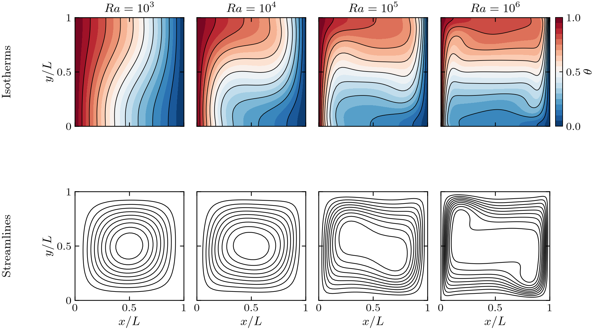
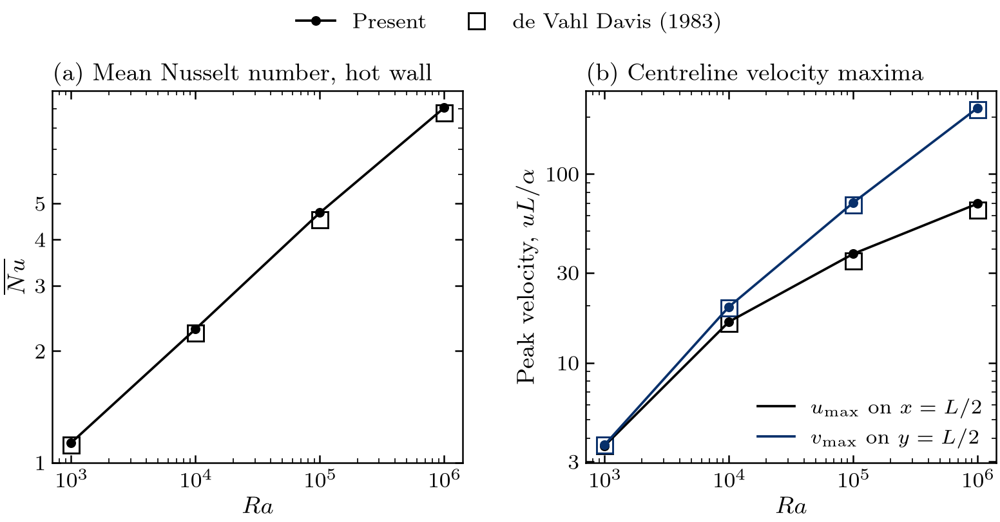

# Scenario 2 — Differentially Heated Cavity

| | |
|---|---|
| **Physics** | natural convection in a closed square cavity with one hot and one cold vertical wall |
| **Equations** | continuity + momentum with Boussinesq buoyancy + energy |
| **Swept parameter** | Rayleigh number $Ra$, at fixed Prandtl number $Pr = 0.71$ (air) |
| **Reference** | de Vahl Davis (1983), $Ra = 10^3$–$10^6$ |
| **Status** | validated: $\overline{Nu}$ within 1.2 / 2.2 / 4.5 / 2.9 % at $Ra = 10^3$ / $10^4$ / $10^5$ / $10^6$ |
| **Input folder** | [input/differentially_heated_cavity/](../../input/differentially_heated_cavity/) |
| **Output folder** | `output/differentially_heated_cavity/` |
| **Plotter** | [plotters/plot_dhc.py](../../plotters/plot_dhc.py) |

> **Read §4 before running.** The scheme is fully explicit and the shipped
> inputs (120×120 stretched grid, `dt = 1e-5`) **diverge**; the validated
> results were computed on uniform grids with the settings given there.

---

## Contents

1. [Physical problem](#1-physical-problem)
2. [Governing equations](#2-governing-equations)
3. [Boundary and initial conditions](#3-boundary-and-initial-conditions)
4. [Numerical set-up and stability](#4-numerical-set-up-and-stability)
5. [Code path](#5-code-path)
6. [How to run](#6-how-to-run)
7. [Outputs and post-processing](#7-outputs-and-post-processing)
8. [Validation results](#8-validation-results)
9. [Known limitations](#9-known-limitations)
10. [References](#10-references)

---

## 1. Physical problem

A square cavity of side $L$, closed on all sides. The left wall is held at
the hot temperature $T_h$, the right wall at the cold temperature $T_c$, and
the top and bottom walls are insulated. Fluid heated at the left wall rises,
crosses the top, cools at the right wall and sinks, forming a single
clockwise convection cell. At low $Ra$ heat crosses the cavity mostly by
conduction (nearly vertical isotherms); as $Ra$ grows the isotherms bend,
thin thermal boundary layers form along the vertical walls and the core
becomes thermally stratified.

```
                       u = v = 0,   ∂θ/∂n = 0   (adiabatic)
        y = H = 1  ┌─────────────────────────────────┐
                   │  →  →  →  →  →  →  →  →  →  →   │
   θ = 1 (hot)     │ ↑                             ↓ │   θ = 0 (cold)
   u = v = 0       │ ↑          ↻  one cell        ↓ │   u = v = 0
                   │ ↑                             ↓ │
                   │  ←  ←  ←  ←  ←  ←  ←  ←  ←  ←   │       g ↓
        y = 0      └─────────────────────────────────┘
                 x = 0     u = v = 0,  ∂θ/∂n = 0    x = L = 1
```

## 2. Governing equations

Non-dimensional in the de Vahl Davis scaling: length $L$, velocity
$\alpha/L$, time $L^2/\alpha$, $\theta = (T - T_c)/(T_h - T_c)$
([../theory/equations.md §2.2](../theory/equations.md#22-differentially-heated-cavity-de-vahl-davis-1983-scaling)):

$$
\nabla\cdot\mathbf{u} = 0
$$

$$
\frac{\partial\mathbf{u}}{\partial t} + (\mathbf{u}\cdot\nabla)\mathbf{u}
= -\nabla p + Pr\,\nabla^2\mathbf{u} + Ra\,Pr\,\theta\,\hat{\mathbf{e}}_y
$$

$$
\frac{\partial\theta}{\partial t} + (\mathbf{u}\cdot\nabla)\theta = \nabla^2\theta
$$

$$
Ra = \frac{g\beta_T (T_h - T_c) L^3}{\nu\alpha},\qquad Pr = \frac{\nu}{\alpha}
$$

In the code: `nu = Pr` (momentum diffusion), `alpha = 1` (thermal
diffusion), and the buoyancy enters as an explicit increment
`dt * Ra * Pr * theta` added to $v^*$ after the momentum predictor and before
the pressure projection ([Buoyancy.hpp](../../src/Buoyancy.hpp)). Using
$\theta$ instead of $\theta - \theta_{ref}$ only adds a hydrostatic pressure
field, which the projection absorbs. The energy equation is advanced last,
with the divergence-free velocity of the new step.

## 3. Boundary and initial conditions

| Boundary | $u$ | $v$ | $p$ | $\theta$ | Input lines |
|---|---|---|---|---|---|
| West, $x = 0$ | 0 | 0 | $\partial p/\partial n = 0$ | $1$ (hot) | `WALL` / `hot_west WEST 0 9999 WALL_ISOTHERMAL 1.0` |
| East, $x = L$ | 0 | 0 | $\partial p/\partial n = 0$ | $0$ (cold) | `WALL` / `cold_east EAST 0 9999 WALL_ISOTHERMAL 0.0` |
| South, $y = 0$ | 0 | 0 | $\partial p/\partial n = 0$ | $\partial\theta/\partial n = 0$ | `WALL` / `bottom SOUTH 0 9999 WALL_ADIABATIC 0.0` |
| North, $y = H$ | 0 | 0 | $\partial p/\partial n = 0$ | $\partial\theta/\partial n = 0$ | `WALL` / `top NORTH 0 9999 WALL_ADIABATIC 0.0` |

Velocity conditions come from
[boundaries.txt](../../input/differentially_heated_cavity/boundaries.txt)
(four no-slip walls, no lid), temperature conditions from
[boundaries_T.txt](../../input/differentially_heated_cavity/boundaries_T.txt);
a side missing from `boundaries_T.txt` defaults to adiabatic. Implementation
([../theory/boundary_conditions.md](../theory/boundary_conditions.md)):

- velocity: as in the lid-driven cavity, with all tangential wall values 0;
- temperature: image ghosts, $\theta_{ghost} = 2\theta_w - \theta_P$ on the
  isothermal walls and $\theta_{ghost} = \theta_P$ on the adiabatic walls
  ([EnergySolver.cpp:59-75](../../src/EnergySolver.cpp#L59-L75)); the
  convective flux through every wall is zero;
- pressure: Neumann on all walls, $p = 0$ pinned in the south-west cell.

**Initial condition:** $u = v = p = 0$ and $\theta = 0.5$ everywhere
([main.cpp:327-339](../../src/main.cpp#L327-L339)). The hot and cold walls
then drive the flow from rest; the start-up transient is the most
demanding part of the run for the time step.

## 4. Numerical set-up and stability

**Stability.** Momentum and energy are explicit. With $\nu = Pr$ and
$\alpha = 1$ both $O(1)$, the diffusion limit
$\Delta t \lesssim h_{\min}^2/(8\max(\nu,\alpha)) = h_{\min}^2/8$ is far
stricter than in the lid-driven cavity
([../theory/equations.md §6](../theory/equations.md#6-stability-of-the-explicit-scheme)).
At high $Ra$ the velocities ($v_{\max} \approx 220$ at $Ra = 10^6$) tighten
the convective limit $\Delta t \lesssim h_{\min}/|\mathbf{u}|_{\max}$ as well.

| Grid | $h_{\min}$ | $h_{\min}^2/8$ | `dt` used | Result |
|---|---|---|---|---|
| uniform 40×40 | 0.025 | $7.8\times10^{-5}$ | $2\times10^{-5}$ | stable, $Ra = 10^3$–$10^5$ |
| uniform 100×100 | 0.010 | $1.25\times10^{-5}$ | $2.5\times10^{-6}$ | stable, $Ra = 10^6$ |
| shipped 120×120, $\beta = 0.8$ | 0.0056 | $3.9\times10^{-6}$ | $10^{-5}$ | **diverges** (NaN after ≈ 2000 steps at $Ra = 10^4$, checked 2026-10-30) |

**Shipped inputs** ([sim_params.txt](../../input/differentially_heated_cavity/sim_params.txt),
[stretch.txt](../../input/differentially_heated_cavity/stretch.txt)):

| Item | Value | Notes |
|---|---|---|
| Domain | $L = H = 1$ | single zone |
| Grid | 120×120, `beta_x_west = beta_y_south = 0.8` | refined towards the **cold** wall and the top only — not towards the hot wall where $\overline{Nu}$ is measured ([mesh.md §4](../theory/mesh.md#4-mesh-stretching-refinement)) |
| `dt` | `1e-5` | above the diffusion limit of this grid → diverges |
| `solve_energy`, `Pr` | `1`, `0.71` | `solve_energy = 1` is required, else the energy equation stays off |
| `max_steps`, `ss_tol` | `200000`, `0.0` | `ss_tol = 0` → runs all steps |
| Convection | momentum CDS; energy first-order upwind | set in [main.cpp:333-338](../../src/main.cpp#L333-L338) |
| Pressure solver | CG, warm start, serial | |
| Cases | `rayleigh_cases.txt`: `1e4` | empty file → $10^3, 10^4, 10^5, 10^6$ |

**Settings of the validated runs:**

| $Ra$ | Grid | `dt` | Steps / end time | Notes |
|---|---|---|---|---|
| $10^3$, $10^4$, $10^5$ | uniform 40×40 | $2\times10^{-5}$ | not recorded (runs predate `tools/run_case.sh`) | stored in `Ra_<N>/` without `input/` |
| $10^6$ | uniform 100×100 | $2.5\times10^{-6}$ | 160 000 steps, $t = 0.4$ | residual $\lVert\Delta u\rVert_\infty/\Delta t \approx 0.02$ against velocities $O(200)$; inputs in `Ra_1000000/input/` |

## 5. Code path

Same core as the lid-driven cavity, plus two modular pieces that never touch
`MomentumSolver` or `PressurePoissonSystem`:

| Stage | Function | File |
|---|---|---|
| Activate energy | `energy_on = (scenario == DHC) && solve_energy != 0` | [main.cpp:222-223](../../src/main.cpp#L222-L223) |
| Read $Ra$ list and θ BCs | `read_rayleigh_cases`, `define_temperature_boundaries` | [main.cpp:229-233](../../src/main.cpp#L229-L233), [MeshGenerator.cpp:1086](../../src/mesh/MeshGenerator.cpp#L1086) |
| Per case: coefficients | `nu = Pr`; `EnergySolver(..., alpha = 1, UPWIND)`; `T = 0.5` | [main.cpp:305-339](../../src/main.cpp#L305-L339) |
| Predictor + BCs | `MomentumSolver::advance`, `applyBoundaryConditions` | [main.cpp:363-372](../../src/main.cpp#L363-L372) |
| Buoyancy | `addBuoyancy(T, v*, dt, Ra, Pr, ...)`: $\theta$ averaged to each interior $v$-node, $v^* \mathrel{+}= \Delta t\,Ra\,Pr\,\theta$ | [Buoyancy.hpp](../../src/Buoyancy.hpp), [main.cpp:374](../../src/main.cpp#L374) |
| Pressure + projection | `computeRHS`, `CG::solve`, `projectVelocity` | [main.cpp:375-388](../../src/main.cpp#L375-L388) |
| Energy | `EnergySolver::advance` → `tRHS` (upwind FV convection, image-ghost diffusion, AB2) | [EnergySolver.cpp:48-136](../../src/EnergySolver.cpp#L48) |
| Metrics | $u_{\max}$, $v_{\max}$, $\overline{Nu}$ → `dhc_metrics.csv` | [main.cpp:597-651](../../src/main.cpp#L597-L651) |

The complete trace from input files to the energy solver, with every
equation discretised step by step, is in
[../reference/dhc_implementation.md](../reference/dhc_implementation.md).

## 6. How to run

```bash
bash run.sh build

# Ra = 1e3 ... 1e5 as validated: uniform 40x40, dt = 2e-5
tools/run_case.sh differentially_heated_cavity 1e4 \
    --stretch N_cells_west=40 --stretch M_cells_west=40 \
    --stretch beta_x_west=0.0 --stretch beta_y_south=0.0 \
    --set dt=2e-5 --threads 1

# Ra = 1e6 as validated: uniform 100x100, dt = 2.5e-6, t = 0.4
tools/run_case.sh differentially_heated_cavity 1e6 \
    --stretch N_cells_west=100 --stretch M_cells_west=100 \
    --stretch beta_x_west=0.0 --stretch beta_y_south=0.0 \
    --set dt=2.5e-6 --set max_steps=160000 --set ss_tol=0.0 --threads 1

python3 plotters/plot_dhc.py
```

With the shipped `max_steps = 200000` and `ss_tol = 0.0`, the 40×40 command
runs to $t = 4$ diffusive time units. To use `bash run.sh mesh_gen`
instead, set `scenario = differentially_heated_cavity` in
`input/scenario.txt` and edit `stretch.txt`/`sim_params.txt` as above.

## 7. Outputs and post-processing

Written by the solver, per case, in `output/differentially_heated_cavity/Ra_<N>/`:

| File | Content |
|---|---|
| `fields/pressure.vtk`, `u_velocity.vtk`, `v_velocity.vtk`, `temperature.vtk` | final fields |
| `data/dhc_metrics.csv` | `Ra, Pr, u_max, v_max, Nu_avg` |

How the metrics are computed ([main.cpp:603-640](../../src/main.cpp#L603-L640)):

- $u_{\max}$: maximum of $\lvert u\rvert$ along the $u$-column nearest
  $x = L/2$ (no interpolation between nodes);
- $v_{\max}$: maximum of $\lvert v\rvert$ along the $v$-row nearest $y = H/2$;
- $\overline{Nu}$: mean heat flux through the hot wall,
  $\overline{Nu} = \frac{1}{H}\sum_j \frac{\theta_w - \theta_{1,j}}{x_1 - x_w}\,\Delta y_j$,
  a one-sided first-order difference between the wall and the first cell
  centre.

`plotters/plot_dhc.py` writes `Ra_<N>/figures/flow_fields` (isotherms and
streamlines), and in `output/differentially_heated_cavity/`:
`figures/fields_overview`, `figures/benchmark` ($\overline{Nu}$, $u_{\max}$,
$v_{\max}$ against de Vahl Davis) and `validation_summary.csv` (values,
references and relative errors).

## 8. Validation results

Isotherms and streamlines, $Pr = 0.71$:





From `output/differentially_heated_cavity/validation_summary.csv`:

| $Ra$ | Grid | $\overline{Nu}$ | Ref. | Error | $u_{\max}$ | Ref. | Error | $v_{\max}$ | Ref. | Error |
|---|---|---|---|---|---|---|---|---|---|---|
| $10^3$ | 40×40 | 1.131 | 1.118 | 1.2 % | 3.643 | 3.649 | 0.2 % | 3.685 | 3.697 | 0.3 % |
| $10^4$ | 40×40 | 2.293 | 2.243 | 2.2 % | 16.51 | 16.18 | 2.0 % | 19.82 | 19.62 | 1.0 % |
| $10^5$ | 40×40 | 4.722 | 4.519 | 4.5 % | 37.78 | 34.73 | 8.8 % | 70.52 | 68.59 | 2.8 % |
| $10^6$ | 100×100 | 9.059 | 8.800 | 2.9 % | 69.65 | 64.63 | 7.8 % | 223.8 | 219.4 | 2.0 % |

- The trends with $Ra$ are reproduced over three decades; every quantity is
  within 3 % of the reference at $Ra \leq 10^4$.
- The largest errors are in $u_{\max}$ at $Ra = 10^5$ (8.8 %, 40×40) and
  $Ra = 10^6$ (7.8 %, 100×100): the horizontal velocity peaks in the thin
  layers near the top and bottom walls, which these uniform grids resolve
  with few points, and $u_{\max}$ is taken at the nearest node without
  interpolation. No grid study has been done yet; these errors are expected
  to shrink with refinement.
- $\overline{Nu}$ is evaluated with a first-order one-sided difference at
  the hot wall, which on coarse grids also contributes to its error.

## 9. Known limitations

- **Explicit scheme:** `dt` must follow the grid (§4). The shipped inputs
  diverge; use the validated settings or reduce `dt` below
  $h_{\min}^2/8$.
- **Shipped grid stretching** refines the wrong wall for $\overline{Nu}$ (§4).
- **Temperature conditions are uniform per side** (first face of each side),
  so partially heated walls are not possible
  ([../theory/boundary_conditions.md §10](../theory/boundary_conditions.md#10-limitations-what-is-not-implemented)).
- **No grid-convergence study** yet for $Ra = 10^5$, $10^6$.

## 10. References

- G. de Vahl Davis, *Natural convection of air in a square cavity: a bench
  mark numerical solution*, Int. J. Numer. Methods Fluids 3 (1983) 249–264.
  Reference values used: $\overline{Nu}$ (mean over the hot wall),
  $u_{\max}$ on $x = 1/2$, $v_{\max}$ on $y = 1/2$, all at $Pr = 0.71$.
