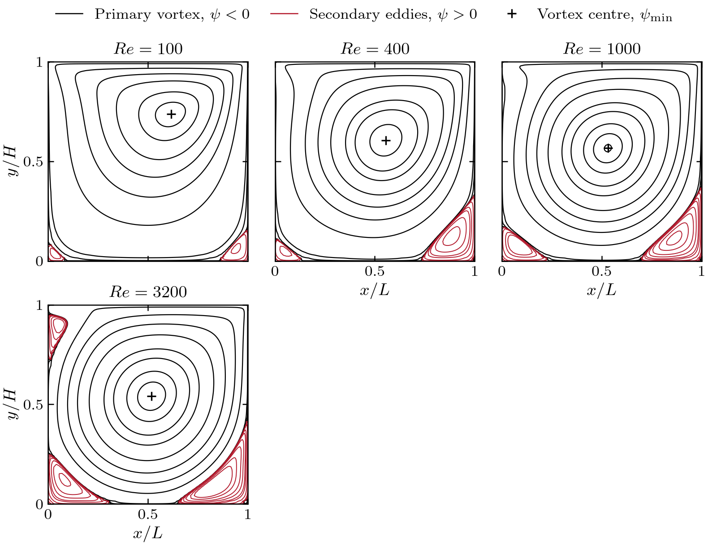
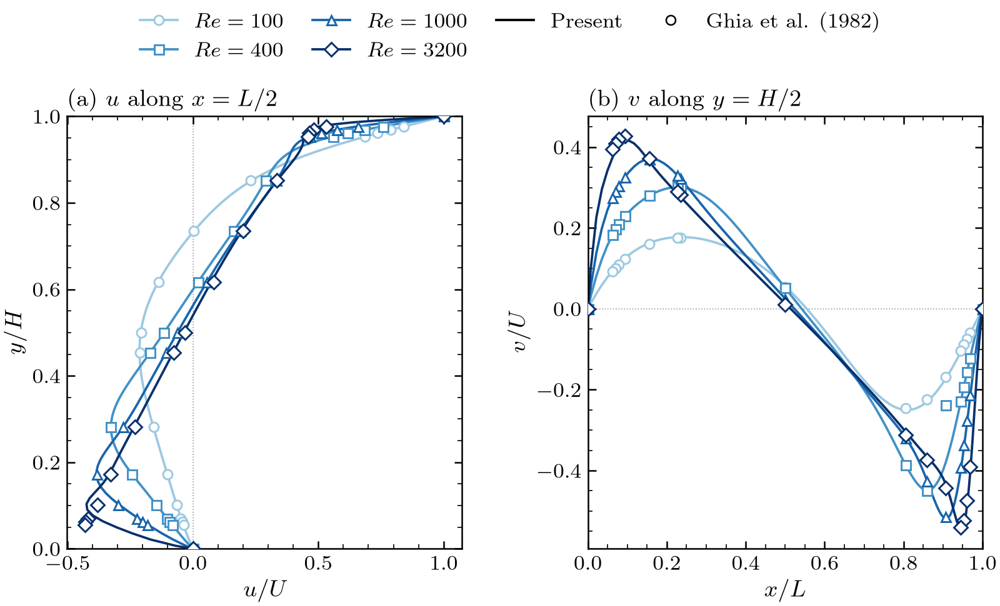

# Scenario 1 — Lid-Driven Cavity

| | |
|---|---|
| **Physics** | isothermal incompressible flow in a closed square cavity driven by a sliding lid |
| **Equations** | continuity + momentum |
| **Swept parameter** | Reynolds number $Re = U_{lid}L/\nu$ |
| **Reference** | Ghia, Ghia & Shin (1982), $Re = 100$–$10\,000$ |
| **Status** | validated: $\psi_{\min}$ within 0.05–0.3 % up to $Re = 1000$, 2.5 % at $Re = 3200$ |
| **Input folder** | [input/lid_driven_cavity/](../../input/lid_driven_cavity/) |
| **Output folder** | `output/lid_driven_cavity/` |
| **Plotter** | [plotters/plot_results.py](../../plotters/plot_results.py) |

---

## Contents

1. [Physical problem](#1-physical-problem)
2. [Governing equations](#2-governing-equations)
3. [Boundary and initial conditions](#3-boundary-and-initial-conditions)
4. [Numerical set-up](#4-numerical-set-up)
5. [Code path](#5-code-path)
6. [How to run](#6-how-to-run)
7. [Outputs and post-processing](#7-outputs-and-post-processing)
8. [Validation results](#8-validation-results)
9. [Known limitations](#9-known-limitations)
10. [References](#10-references)

---

## 1. Physical problem

A square cavity of side $L$ filled with fluid. The top wall (the lid) slides
to the right at constant speed $U_{lid}$; the other three walls are at rest.
The shear at the lid drives a primary clockwise vortex. As $Re$ grows the
vortex centre moves towards the cavity centre, counter-rotating secondary
eddies grow in the bottom corners, and a third eddy appears in the top-left
corner around $Re \approx 3200$. The flow is steady over the whole range
benchmarked by Ghia et al.

```
                    u = U_lid = 1,  v = 0          (lid: WALL_FIXED_VALUE 1.0)
        y = H = 1  ┌────────────────────────────────►┐
                   │                                 │
                   │        ↻ primary vortex         │
   u = 0, v = 0    │                                 │   u = 0, v = 0
   (WALL)          │                                 │   (WALL)
                   │ ↺                             ↺ │
        y = 0      └─────────────────────────────────┘
                 x = 0       u = 0, v = 0 (WALL)    x = L = 1
```

## 2. Governing equations

Non-dimensional with $L$, $U_{lid}$ and $\rho U_{lid}^2$
([../theory/equations.md §2.1](../theory/equations.md#21-lid-driven-cavity)):

$$
\nabla\cdot\mathbf{u} = 0,\qquad
\frac{\partial\mathbf{u}}{\partial t} + (\mathbf{u}\cdot\nabla)\mathbf{u}
= -\nabla p + \frac{1}{Re}\nabla^2\mathbf{u}
$$

The code takes $\rho = 1$, $U_{lid} = 1$, $L = 1$ from the input files and
sets `nu = U_lid * L_domain / Re` for each $Re$ of the sweep
([main.cpp:311](../../src/main.cpp#L311)). The steady solution is reached by
time-marching until $\lVert u^{n+1}-u^n\rVert_\infty/\Delta t <$ `ss_tol`.

## 3. Boundary and initial conditions

| Boundary | $u$ | $v$ | $p$ | `boundaries.txt` line |
|---|---|---|---|---|
| North, $y = H$ (lid) | $U_{lid} = 1$ | $0$ | $\partial p/\partial n = 0$ | `lid  NORTH 0 9999 WALL_FIXED_VALUE 1.0` |
| South, $y = 0$ | $0$ | $0$ | $\partial p/\partial n = 0$ | `wall_south SOUTH 0 9999 WALL 0.0` |
| West, $x = 0$ | $0$ | $0$ | $\partial p/\partial n = 0$ | `wall_west WEST 0 9999 WALL 0.0` |
| East, $x = L$ | $0$ | $0$ | $\partial p/\partial n = 0$ | `wall_east EAST 0 9999 WALL 0.0` |

How they are imposed on the staggered grid
([../theory/boundary_conditions.md](../theory/boundary_conditions.md)):

- **Normal velocity** ($u$ on west/east, $v$ on south/north) lies on the
  wall and is set to 0 by `applyBoundaryConditions`.
- **Tangential velocity** uses image ghosts: under the lid
  $u_{ghost} = 2U_{lid} - u_P$, at the other walls $\phi_{ghost} = -\phi_P$,
  with the wall distance doubled.
- **Pressure:** homogeneous Neumann on all four walls, so $p$ is defined up
  to a constant; the solver fixes $p = 0$ in the south-west corner cell
  (`pinReferencePressure`). Only pressure differences are meaningful.
- **Corner singularity:** the two top corners see $u$ jump from 0 to
  $U_{lid}$. Nothing special is done; the staggered layout keeps the corner
  $u$-nodes on the side walls ($u = 0$) and applies the lid only through the
  ghosts of the interior $u$-columns.

**Initial condition:** fluid at rest, $u = v = p = 0$
([main.cpp:327-334](../../src/main.cpp#L327-L334)), then the boundary values
are applied. Every case of the sweep starts from rest.

## 4. Numerical set-up

| Item | Shipped input | Notes |
|---|---|---|
| Domain | $L = H = 1$, `W_depth = 0.1` | [data.txt](../../input/lid_driven_cavity/data.txt); all zone nodes at (1, 1) → one zone |
| Grid | 120×120, `beta_x_west = beta_y_south = 0.8` | [stretch.txt](../../input/lid_driven_cavity/stretch.txt); refined towards $x = L$ and $y = H$ only, $h$ from 0.0144 to 0.0056 ([mesh.md §4](../theory/mesh.md#4-mesh-stretching-refinement)) |
| Time step | `dt = 1e-3` | stable for $Re \geq 400$ on this grid; $Re = 100$ needs `dt = 3e-4` (diffusion limit $h_{\min}^2/(8\nu) = 3.9\times10^{-4}$) |
| Steps | `max_steps = 200000` | |
| Steady-state tolerance | `ss_tol = 0.0` | **0 disables the early stop**: the run lasts `max_steps`. The validation runs used `1e-5` |
| Convection | CDS (2nd order) | set in [main.cpp:333](../../src/main.cpp#L333) (default argument) |
| Pressure solver | CG, warm start, serial | $\lVert r\rVert < 10^{-6}\lVert b\rVert$ |
| Cases | `reynolds_cases.txt`: `3200` | empty file → 100, 200, …, 1000 |

Settings of the stored validation runs (all on the shipped 120×120 grid; the
exact inputs are kept in `output/lid_driven_cavity/Re_<N>/input/`):

| $Re$ | `dt` | `max_steps` | `ss_tol` | Outcome |
|---|---|---|---|---|
| 100 | 3e-4 | 100 000 | 1e-5 | steady at step 59 200 |
| 400 | 1e-3 | 200 000 | 1e-5 | steady at step 41 900 |
| 1000 | 1e-3 | 200 000 | 1e-5 | steady at step 76 400 |
| 3200 | 1e-3 | 200 000 | 1e-5 | ran to `max_steps`, residual $2.9\times10^{-5}$ |
| 5000 | 1e-3 | 200 000 | 1e-5 | ran to `max_steps`, residual $1.9\times10^{-4}$ |
| 7500 | 1e-3 | 250 000 | 1e-5 | ran to `max_steps`, residual $4.0\times10^{-3}$ |

$Re = 200$–$900$ in `output/` are older runs on a uniform 40×40 grid, kept
only for the $\psi_{\min}$ trend.

## 5. Code path

What runs, in order, for this scenario (`scenario = lid_driven_cavity`):

| Stage | Function | File |
|---|---|---|
| Select scenario | `read_scenario_name` | [main.cpp:39](../../src/main.cpp#L39) |
| Read inputs | `get_data`, `get_stretch`, `get_sim_params` | [MeshGenerator.cpp:708-787](../../src/mesh/MeshGenerator.cpp#L708) |
| Build P, U, V grids | `generate_mesh`, `generate_u_mesh`, `generate_v_mesh` | [MeshGenerator.cpp:152](../../src/mesh/MeshGenerator.cpp#L152) |
| Boundary conditions | `define_boundaries`, `build_connectivity` | [MeshGenerator.cpp:996](../../src/mesh/MeshGenerator.cpp#L996) |
| Pressure matrix | `PressurePoissonSystem::assembleMatrix` → `LaplaceOperator`, then `pinReferencePressure` | [main.cpp:189-203](../../src/main.cpp#L189-L203) |
| Per case: viscosity | `nu = U_lid * L / Re` | [main.cpp:311](../../src/main.cpp#L311) |
| Predictor | `MomentumSolver::advance` (+ `DiffusionOperator`) | [MomentumSolver.cpp:359](../../src/MomentumSolver.cpp#L359) |
| Boundary values | `MomentumSolver::applyBoundaryConditions` | [MomentumSolver.cpp:84](../../src/MomentumSolver.cpp#L84) |
| Pressure equation | `computeRHS` → `CG::solve` | [PressurePoissonSystem.cpp:147](../../src/PressurePoissonSystem.cpp#L147) |
| Projection | `projectVelocity` (+ `GradientOperator`) | [PressurePoissonSystem.cpp:190](../../src/PressurePoissonSystem.cpp#L190) |
| Convergence check | $\lVert\Delta u\rVert_\infty/\Delta t$ every 100 steps | [main.cpp:402-426](../../src/main.cpp#L402-L426) |
| Output | VTK fields, centreline CSVs, Ghia table to console | [main.cpp:432-589](../../src/main.cpp#L432-L589) |

Function-by-function walkthrough of this exact path:
[../reference/algorithm_walkthrough.md](../reference/algorithm_walkthrough.md).

## 6. How to run

```bash
bash run.sh build                       # once, after any code change

# Option A — the shipped inputs
#   input/scenario.txt:                    scenario = lid_driven_cavity
#   input/lid_driven_cavity/reynolds_cases.txt: the Re values to sweep
bash run.sh mesh_gen

# Option B — one case in an isolated copy, with overrides (recommended)
tools/run_case.sh lid_driven_cavity 1000 --set dt=1e-3 --set ss_tol=1e-5 --threads 1
tools/run_case.sh lid_driven_cavity 100  --set dt=3e-4 --set max_steps=100000 --set ss_tol=1e-5 --threads 1

# Figures and validation table
python3 plotters/plot_results.py
```

Option B never edits the committed `input/` files and stores the exact
inputs with the result ([../getting_started.md](../getting_started.md#4-running-individual-cases-toolsrun_casesh)).

## 7. Outputs and post-processing

Written by the solver, per case, in `output/lid_driven_cavity/Re_<N>/`:

| File | Content |
|---|---|
| `fields/pressure.vtk`, `u_velocity.vtk`, `v_velocity.vtk` | final fields on their own staggered grids (ParaView) |
| `data/centerline_u.csv` | `y, y_norm, u, u_norm` — $u$ on the vertical line nearest $x = L/2$ |
| `data/centerline_v.csv` | `x, x_norm, v, v_norm` — $v$ on the horizontal line nearest $y = H/2$ |
| `data/run.log`, `input/` | log and inputs (only for runs made with `tools/run_case.sh`) |

The grids go to `output/lid_driven_cavity/mesh/`. The solver also prints the
Ghia column closest to the case's $Re$ to the console.

`plotters/plot_results.py` writes:

| Output | Content |
|---|---|
| `Re_<N>/figures/flow_fields` | stream function (Ghia's contour levels), vorticity, pressure |
| `Re_<N>/figures/centerlines` | centreline profiles vs. Ghia (only for tabulated $Re$) |
| `figures/centerline_comparison`, `centerline_trend`, `streamfunction_overview` | cross-case figures |
| `validation_summary.csv` | per case: grid, $\psi_{\min}$ and its location, the Ghia values, RMS/max centreline errors |

$\psi$ and $\omega$ are computed exactly on the MAC grid
([../theory/equations.md §7](../theory/equations.md#7-derived-quantities-used-for-validation)).
Ghia's tables are embedded in the plotter and in `main.cpp`;
[ghia_reference.txt](../../input/lid_driven_cavity/ghia_reference.txt) is a
human-readable copy that the code does not read.

## 8. Validation results

Stream function for the resolved runs and centreline profiles against Ghia
et al. (lines: present; symbols: reference):





From `output/lid_driven_cavity/validation_summary.csv` (120×120 grid):

| $Re$ | $\psi_{\min}$ | Ghia | Error | Vortex centre | Ghia | RMS $\Delta u$ | RMS $\Delta v$ |
|---|---|---|---|---|---|---|---|
| 100 | −0.1035 | −0.1034 | 0.05 % | (0.616, 0.737) | (0.617, 0.734) | 0.0015 | 0.0028 |
| 400 | −0.1136 | −0.1139 | 0.30 % | (0.554, 0.606) | (0.555, 0.606) | 0.0009 | 0.037 † |
| 1000 | −0.1177 | −0.1179 | 0.22 % | (0.531, 0.566) | (0.531, 0.563) | 0.0028 | 0.0027 |
| 3200 | −0.1173 | −0.1204 | 2.5 % | (0.518, 0.541) | (0.517, 0.547) | 0.0385 | 0.0120 |
| 5000 ‡ | −0.1137 | −0.1190 | 4.5 % | (0.516, 0.537) | (0.512, 0.535) | 0.0244 | 0.0163 |
| 7500 ‡ | −0.1074 | −0.1200 | 10.5 % | (0.514, 0.534) | (0.512, 0.532) | 0.0251 | 0.0267 |

- Up to $Re = 1000$ the solution is grid-converged in practice: $\psi_{\min}$
  within 0.3 % and the vortex centre within 0.003.
- † $Re = 400$, $v$ profile: the RMS error is dominated by one reference
  point, $x/L = 0.9063$, where the embedded table gives $-0.23827$. The
  present solution ($-0.3816$) agrees with the other 14 points of that column
  to 0.001, and the tabulated value breaks the monotonic trend of its own
  column ($-0.228,\,-0.238,\,-0.450$). It looks like a transcription error;
  **check it against Table II of the paper** before quoting the $Re = 400$
  $v$ error (0.037 with it, ≈ 0.003 without).
- ‡ $Re = 5000$ and $7500$ did not reach the steady-state tolerance (see §4)
  and are under-resolved on this grid; they are not shown in the figures
  above. The error grows with $Re$ because the grid is refined only towards
  the lid and the east wall (§4), while the secondary eddies that strengthen
  at high $Re$ sit in the bottom corners.

## 9. Known limitations

- **Single-corner refinement.** With one zone only `beta_x_west` and
  `beta_y_south` act, so the shipped grid is refined towards the lid and the
  east wall, not the west and bottom walls
  ([../theory/mesh.md §4](../theory/mesh.md#4-mesh-stretching-refinement)).
- **Shipped `ss_tol = 0.0`** makes every case run to `max_steps`; set it to
  `1e-5` (or use `tools/run_case.sh --set ss_tol=1e-5`) to stop at steady
  state.
- **Stretched-grid accuracy.** The pressure Laplacian is first-order on
  non-uniform grids ([../reference/operators_verification.md](../reference/operators_verification.md), Suite 10).
- **Convection scheme** is fixed in the code (CDS); switching to upwind
  means editing the `MomentumSolver` construction in `main.cpp`.

## 10. References

- U. Ghia, K. N. Ghia, C. T. Shin, *High-Re solutions for incompressible flow
  using the Navier–Stokes equations and a multigrid method*, J. Comput. Phys.
  48 (1982) 387–411. Tables I ($u$ on $x = L/2$) and II ($v$ on $y = H/2$);
  primary-vortex $\psi_{\min}$ and centre from its Table III.
