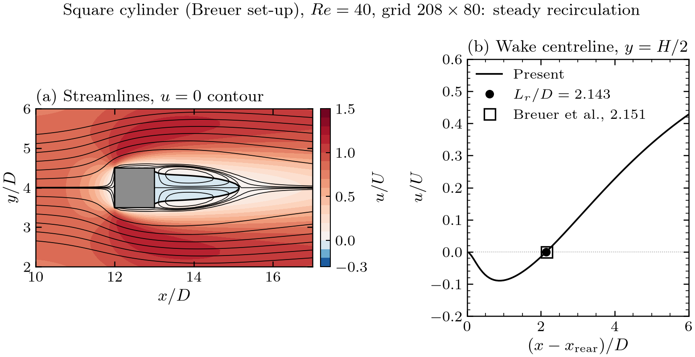
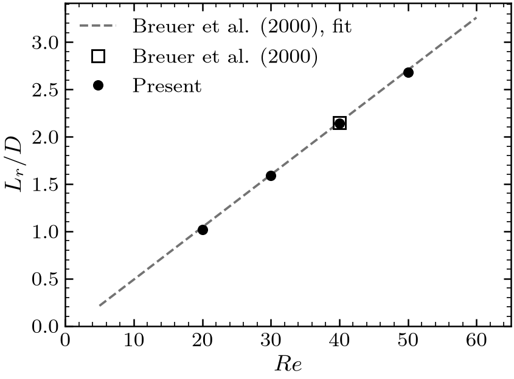
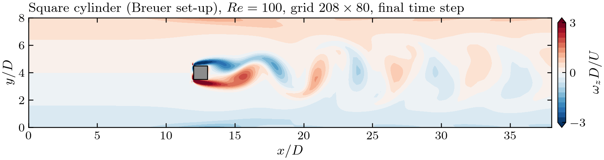
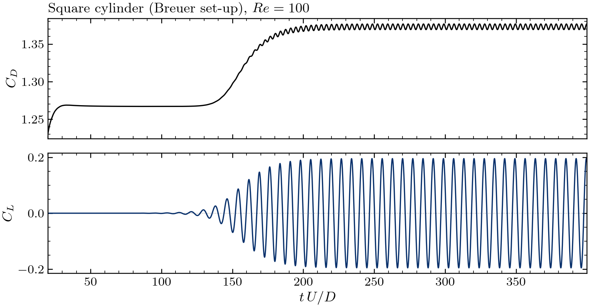
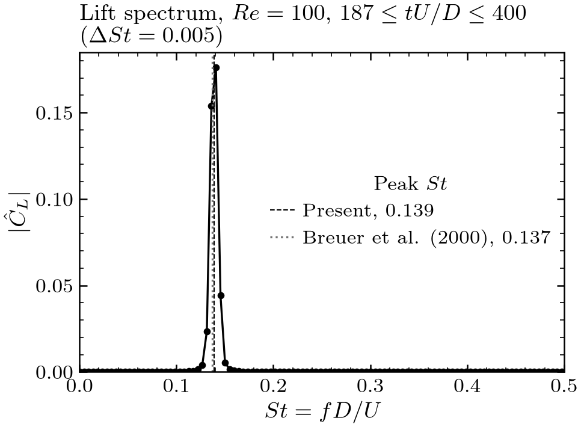
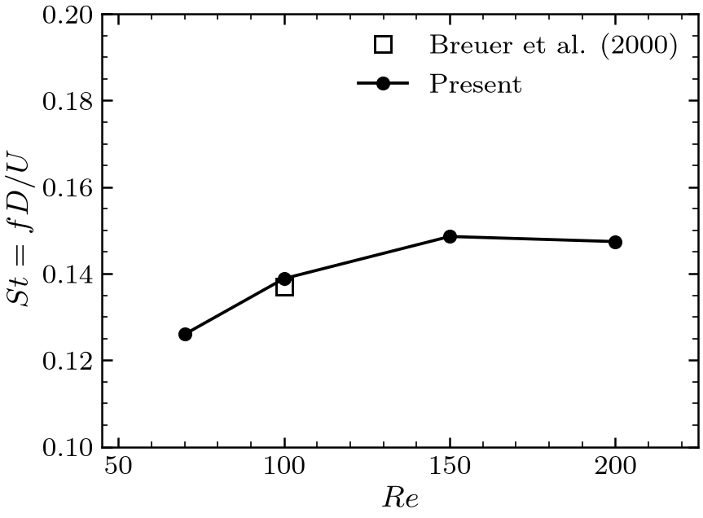

# Scenario 3 — Square Cylinder in a Channel

| | |
|---|---|
| **Physics** | flow past a square obstacle (side $D$) between two channel walls: steady wake, then periodic vortex shedding |
| **Equations** | continuity + momentum, with an immersed solid obstacle |
| **Swept parameter** | Reynolds number $Re = UD/\nu$ |
| **Variants** | `square_cylinder_breuer` — the benchmark set-up; `square_cylinder` — a shorter channel with uniform inflow (no benchmark) |
| **Reference** | Breuer, Bernsdorf, Zeiser & Durst (2000), blockage $D/H = 1/8$ |
| **Status** | validated: $C_D$ within 0.5 % and $L_r$ −0.4 % at $Re = 40$ (grid-converged); shedding onset between $Re = 50$ and 70 (ref. ≈ 60); $St$ +1.4 % at $Re = 100$ (grid-converged) |
| **Input folders** | [input/square_cylinder_breuer/](../../input/square_cylinder_breuer/), [input/square_cylinder/](../../input/square_cylinder/) |
| **Output folders** | `output/square_cylinder_breuer/`, `output/square_cylinder/` |
| **Plotter** | [plotters/plot_square_cylinder.py](../../plotters/plot_square_cylinder.py) `[scenario]` |

Literature values, the exact configuration of each benchmark and the solver
changes made to reproduce them are in
[square_cylinder_benchmarks.md](square_cylinder_benchmarks.md).

---

## Contents

1. [Physical problem](#1-physical-problem)
2. [Governing equations](#2-governing-equations)
3. [Boundary and initial conditions](#3-boundary-and-initial-conditions)
4. [Numerical set-up](#4-numerical-set-up)
5. [Code path](#5-code-path)
6. [How to run](#6-how-to-run)
7. [Outputs and post-processing](#7-outputs-and-post-processing)
8. [Validation results](#8-validation-results-square_cylinder_breuer)
9. [The `square_cylinder` variant](#9-the-square_cylinder-variant)
10. [Known limitations and next steps](#10-known-limitations-and-next-steps)
11. [References](#11-references)

---

## 1. Physical problem

A square cylinder of side $D$ sits on the centreline of a plane channel of
height $H = 8D$ (blockage $\beta = D/H = 1/8$). Fluid enters from the left
and leaves on the right.

- For $Re \lesssim 60$ the flow is **steady**: two symmetric recirculation
  bubbles form behind the cylinder, of length $L_r$ growing linearly with
  $Re$.
- Above the critical Reynolds number ($Re_{cr} \approx 60$ for this
  blockage), the wake becomes unstable and sheds vortices alternately from
  the top and bottom edges (a von Kármán street). Lift and drag oscillate
  periodically; the shedding frequency is expressed by the Strouhal number
  $St = fD/U$.

```
 Breuer set-up (square_cylinder_breuer), not to scale:

        y = H ┌──────────────────────────────────────────────────────────────┐
              │ u = v = 0  (WALL)                                            │
  u(y) =      │                                                              │  ∂u/∂x = 0
  4 U y(H−y)  │─►           ┌───┐                                            │  v = 0
  ─────────   │──►          │ D │  ~~~ wake ~~~                              │  p = 0
     H²       │─►           └───┘                                            │  (OUTLET)
  v = 0       │                                                              │
  (INLET_     │ u = v = 0  (WALL)                                            │
   PARABOLIC) └──────────────────────────────────────────────────────────────┘
        y = 0 x = 0     12 D (to front face)      37 D (rear face to outlet)   x = 50 D
```

## 2. Governing equations

Non-dimensional with $D$ and the inflow velocity scale $U$
([../theory/equations.md §2.3](../theory/equations.md#23-square-cylinder-both-variants)):

$$
\nabla\cdot\mathbf{u} = 0,\qquad
\frac{\partial\mathbf{u}}{\partial t} + (\mathbf{u}\cdot\nabla)\mathbf{u}
= -\nabla p + \frac{1}{Re}\nabla^2\mathbf{u},\qquad Re = \frac{UD}{\nu}
$$

- **Velocity scale $U$:** the centreline velocity $U_{\max}$ of the
  parabolic inflow in the Breuer set-up (mean velocity $\tfrac23 U_{\max}$),
  the uniform inflow $U_\infty$ in the `square_cylinder` variant. Both are
  the key `U_inf` in `sim_params.txt` (= 1). $Re$, $St$, $C_D$, $C_L$ all use
  this same $U$, as in Breuer et al.
- In the code `nu = U_inf * D / Re`, with $D$ = `obstacle_xmax - obstacle_xmin`
  after snapping the obstacle to the grid ([main.cpp:307-309](../../src/main.cpp#L307-L309)).
- Lengths in the inputs are not divided by $D$ ($D = 0.125$, $H = 1$), so the
  convective time is $t^* = tU/D = 8t$.

Derived quantities ([../theory/equations.md §7](../theory/equations.md#7-derived-quantities-used-for-validation)):

$$
C_D = \frac{F_x}{\tfrac12\rho U^2 D\,W},\qquad
C_L = \frac{F_y}{\tfrac12\rho U^2 D\,W},\qquad
St = \frac{fD}{U}
$$

$F_x, F_y$ are the pressure and viscous forces on the four faces of the
obstacle ([ObstacleForces.cpp](../../src/postprocessing/ObstacleForces.cpp)):
pressure from the adjacent fluid cell, wall shear from a one-sided
difference between the adjacent velocity and the no-slip wall
($\mu\,\partial u/\partial y$ on the top/bottom faces → drag,
$\mu\,\partial v/\partial x$ on the front/rear faces → lift).

## 3. Boundary and initial conditions

| Boundary | $u$ | $v$ | $p$ | `boundaries.txt` line |
|---|---|---|---|---|
| West, $x = 0$ (inlet) | Breuer: $4U_{\max}\,y(H-y)/H^2$; variant: $U_\infty$ | $0$ | $\partial p/\partial n = 0$ | `inlet WEST 0 9999 INLET_PARABOLIC 1.0` / `INLET 1.0` |
| East, $x = L$ (outlet) | $\partial u/\partial x = 0$ | $0$ | $p = 0$ | `outlet EAST 0 9999 OUTLET 0.0` |
| South, $y = 0$ | $0$ | $0$ | $\partial p/\partial n = 0$ | `wall_south SOUTH 0 9999 WALL 0.0` |
| North, $y = H$ | $0$ | $0$ | $\partial p/\partial n = 0$ | `wall_north NORTH 0 9999 WALL 0.0` |
| Cylinder surface | $0$ | $0$ | $\partial p/\partial n = 0$ | `obstacle.txt` bounds |

Implementation ([../theory/boundary_conditions.md](../theory/boundary_conditions.md)):

- **Inlet:** the normal velocity is set face by face; the parabolic profile
  is evaluated at each face centre when the boundaries are read
  ([MeshGenerator.cpp:1051-1065](../../src/mesh/MeshGenerator.cpp#L1051-L1065)).
  The tangential velocity is 0 through the image ghost.
- **Outlet:** $u_{N+1,j} = u_{N,j}$ (zero gradient, refreshed every time the
  BCs are applied); Dirichlet $p = 0$ on the outlet face in the pressure
  matrix; the tangential velocity is imposed as $v = 0$ (image ghost with
  wall value 0). The outlet is 37 $D$ behind the cylinder, where the wake
  is close to parallel.
- **Channel walls:** no-slip, as in the cavities.
- **Cylinder:** P-cells inside `obstacle.txt` are flagged solid
  ([`mark_solid_block`](../../src/mesh/MeshGenerator.cpp#L533)); velocity
  nodes on its surface are 0, tangential stencils next to it use image ghosts
  referenced to the facing obstacle side, and the pressure sees a zero-flux
  wall ([boundary_conditions.md §7](../theory/boundary_conditions.md#7-immersed-solid-obstacle-square-cylinder-only)).
- **Pressure reference:** fixed by the outlet; no pinning.

**Initial condition:** $u = v = p = 0$ in the whole domain, then the inlet
profile is applied — an impulsive start (the first-step drag is
$O(100)$ and is excluded by the statistics windows). Every case starts from
rest. Steady cases ($Re \leq 50$) are run until
$\lVert\Delta u\rVert_\infty/\Delta t <$ `ss_tol`; unsteady cases run for a
fixed number of steps with `ss_tol = 0`.

## 4. Numerical set-up

| Item | `square_cylinder_breuer` (benchmark) | `square_cylinder` (variant) |
|---|---|---|
| Channel | $L = 50D = 6.25$, $H = 8D = 1$ | $L = 25D = 3.125$, $H = 8D = 1$ |
| Cylinder | $x \in [1.5, 1.625]$, $y \in [0.4375, 0.5625]$: front face 12 $D$ from the inlet (centre at $L/4$), 37 $D$ to the outlet | $x \in [0.75, 0.875]$: 6 $D$ from the inlet, 18 $D$ to the outlet |
| Inflow | parabolic, $U_{\max} = 1$ | uniform, $U_\infty = 1$ |
| Grid (zones W/C/E × S/C/N) | 208×80 = (52+16+140) × (32+16+32); $D/16$ uniform across the cylinder, `beta` ±1.6/−1.7 in $x$, ±0.9 in $y$; neighbouring cells differ by < 7 % | 350×260 = (90+40+220) × (110+40+110); $D/40$ across the cylinder, `beta` ±1.5 |
| `dt` | `1e-3` ($0.008\,D/U$) | `1e-5` |
| `max_steps`, `ss_tol` | `30000` ($t^* = 240$), `1e-4` (steady cases) | `200000` ($t^* = 16$), `0.0` |
| Cases | `reynolds_cases.txt`: `40` | `150` |

Common to both: CDS convection, AB2, Jacobi-preconditioned CG (OpenMP,
threads via `OMP_NUM_THREADS` or `tools/run_case.sh --threads`) — the
stretched grids make plain CG too slow. The zone corners in `data.txt` are
placed on the obstacle footprint so that the centre zone is exactly the
cylinder; this only controls the mesh density, the solid is marked
separately from `obstacle.txt` (keep the two consistent). Mind the
explicit diffusion limit $\Delta t \lesssim h_{\min}^2/(8\nu)$ when refining.

Settings of the stored Breuer runs ($D/16$ unless stated; inputs in
`output/square_cylinder_breuer/Re_<N>/input/` where present):

| $Re$ | `dt` | Steps | $t^*$ at end | Stop |
|---|---|---|---|---|
| 20, 30, 40 | 1e-3 | until steady | 86, 101, 111 | `ss_tol = 1e-4` |
| 50 | 1e-3 | 32 000 | 256 | fixed (lift checked for growth) |
| 70 | 1e-3 | 81 000 | 648 | fixed |
| 100 | 1e-3 | 50 000 | 400 | fixed |
| 150, 200 | 1e-3 | 37 500 | 300 | fixed |
| 100, $D/20$ (`--scale 1.25`) | 1e-3 | 50 000 | 400 | fixed |
| 40, $D/12$ / $D/20$ (grid study) | 1.3e-3 / 1e-3 | until steady | — | `ss_tol = 1e-4` |

## 5. Code path

Any scenario name starting with `square_cylinder` runs this branch
([main.cpp:142](../../src/main.cpp#L142)):

| Stage | Function | File |
|---|---|---|
| Mesh + BCs | as in the cavities; `INLET_PARABOLIC` evaluated per face | [MeshGenerator.cpp:996](../../src/mesh/MeshGenerator.cpp#L996) |
| Obstacle | `read_obstacle_bounds` → `mark_solid_block` (snap to faces, flag solid cells, set interface flags) | [main.cpp:167-174](../../src/main.cpp#L167-L174), [MeshGenerator.cpp:533](../../src/mesh/MeshGenerator.cpp#L533) |
| Obstacle mask export | `obstacle_mask.vtk` (1 = solid) | [main.cpp:289-297](../../src/main.cpp#L289-L297) |
| Pressure matrix | `LaplaceOperator`: identity rows in the solid, Neumann at the interface, Dirichlet at the outlet; **no** pinning | [LaplaceOperator.cpp](../../src/operators/LaplaceOperator.cpp), [main.cpp:197](../../src/main.cpp#L197) |
| Per case | `nu = U_inf * D / Re`; open `forces.csv` | [main.cpp:307-355](../../src/main.cpp#L307-L355) |
| Predictor | `MomentumSolver::advance`, skipping surface/solid nodes; obstacle-aware stencils via [ObstacleMask.hpp](../../src/mesh/ObstacleMask.hpp) | [MomentumSolver.cpp:359](../../src/MomentumSolver.cpp#L359) |
| BCs before the PPE | `applyBoundaryConditions` (inlet, outlet copy, surface nodes = 0) | [main.cpp:372](../../src/main.cpp#L372) |
| Pressure | `computeRHS` → `PCG::solve` (Jacobi, OpenMP) → `projectVelocity` | [main.cpp:375-387](../../src/main.cpp#L375-L387) |
| Forces | `ObstacleForces::computeForces` every step → `forces.csv` | [main.cpp:393-400](../../src/main.cpp#L393-L400) |
| Strouhal | `estimate_shedding_frequency` (upward zero crossings of $C_L$, second half of the record) → `strouhal.csv` | [ObstacleForces.cpp](../../src/postprocessing/ObstacleForces.cpp), [main.cpp:446-454](../../src/main.cpp#L446-L454) |

How the obstacle was added to the solver without changing the time loop:
[../theory/solver.md §7](../theory/solver.md#7-the-immersed-solid-obstacle-square-cylinder-scenario).

## 6. How to run

```bash
bash run.sh build

# Steady regime (shipped Breuer inputs stop at ss_tol = 1e-4)
tools/run_case.sh square_cylinder_breuer 40 --threads 4

# Periodic regime: fixed length, ss_tol = 0
tools/run_case.sh square_cylinder_breuer 100 --set max_steps=50000 --set ss_tol=0.0 --threads 4

# Grid study: scale every cell count (D/16 -> D/20), store separately
tools/run_case.sh square_cylinder_breuer 100 --scale 1.25 --set max_steps=50000 \
    --set ss_tol=0.0 --threads 4 --store grid_study/D20

# Figures, force_summary.csv
python3 plotters/plot_square_cylinder.py square_cylinder_breuer
python3 plotters/plot_square_cylinder.py square_cylinder_breuer/grid_study/D20
python3 plotters/plot_square_cylinder.py            # the square_cylinder variant
```

`tools/run_pending_cases.sh` contains the exact commands used for
$Re = 70$–$200$ and the $D/20$ check.

## 7. Outputs and post-processing

Written by the solver:

| File | Content |
|---|---|
| `mesh/obstacle_mask.vtk` | 1 in solid cells — check the obstacle position in ParaView |
| `Re_<N>/fields/pressure.vtk`, `u_velocity.vtk`, `v_velocity.vtk` | fields at the last step (instantaneous for shedding cases) |
| `Re_<N>/data/forces.csv` | `step, time, Cd, Cl` every step |
| `Re_<N>/data/strouhal.csv` | `Re, St` — solver's quick estimate (zero crossings over the second half of the record) |

`plotters/plot_square_cylinder.py [scenario]` writes, per case,
`figures/vorticity`, `figures/force_coefficients`, `figures/lift_spectrum`
(unsteady) and `figures/recirculation` (steady), and per scenario
`figures/strouhal`, `figures/recirculation_length` and `force_summary.csv`.
For the statistics it:

- classifies each case from the lift amplitude in the last quarter of the
  record: *steady* (below $10^{-4}$), *developing* (still growing by more
  than 20 % from the third to the last quarter) or *periodic*;
- takes the **saturated window**: from the first time
  $\lvert C_L - \overline{C_L}\rvert$ reaches 90 % of its final amplitude
  (column `t_star_stats_from`);
- computes $\overline{C_D}$, $\overline{C_L}$, $C_{L,\mathrm{rms}}$ over that
  window, $St$ from the FFT peak of $C_L$ (`St_fft`, resolution
  $1/T_{window}$) and from upward zero crossings (`St_zc`);
- computes $L_r/D$ from the rear face to the first sign change
  (negative → positive) of $u$ on the centreline (steady cases).

## 8. Validation results (`square_cylinder_breuer`)

**Steady regime.** Recirculation at $Re = 40$ and $L_r/D$ over the steady
range against Breuer's linear fit $L_r/D = -0.065 + 0.0554\,Re$:





| $Re$ | $C_D$ | Breuer | $L_r/D$ | Breuer |
|---|---|---|---|---|
| 20 | 2.366 | — | 1.017 | 1.043 (fit) |
| 30 | 1.944 | — | 1.586 | 1.597 (fit) |
| 40 | **1.715** | **1.708** | **2.143** | **2.151** |
| 50 | 1.571 | — | 2.681 | 2.705 (fit) |

Grid study at $Re = 40$ (`output/square_cylinder_breuer/grid_study_Re40.csv`):

| Grid | Cells | $C_D$ | pressure part | friction part | $L_r/D$ |
|---|---|---|---|---|---|
| $D/12$ | 156×60 | 1.7175 | 1.397 | 0.320 | 2.132 |
| $D/16$ | 208×80 | 1.7155 | 1.408 | 0.308 | 2.143 |
| $D/20$ | 260×100 | 1.7173 | 1.419 | 0.299 | 2.150 |
| Breuer et al. | | 1.708 | | | 2.151 |

$C_D$ is grid-independent to 0.1 % and 0.5 % above the reference; $L_r/D$
converges monotonically onto the reference (0.05 % on $D/20$). Halving
$\Delta t$ changes $C_D$ by ≈ 1 % (splitting error of the non-incremental
projection) and $L_r$ by < 0.5 %. Mean lift is zero to round-off
($|C_L| < 10^{-6}$).

**Onset of shedding.** At $Re = 50$ (run to $t^* = 256$) the lift
perturbation stays at round-off level ($\approx 3\times10^{-6}$): steady. At
$Re = 70$ it grows and saturates from $t^* \approx 412$. The onset therefore
lies between 50 and 70, bracketing Breuer's $Re_{cr} \approx 60$.

**Periodic regime.** Vorticity, force history and lift spectrum at
$Re = 100$:







From `output/square_cylinder_breuer/force_summary.csv` (and
`grid_study/D20/force_summary.csv`):

| $Re$ | Window $t^*$ | $St$ (FFT) | $St$ (zero crossings) | $\overline{C_D}$ | $C_{L,\mathrm{rms}}$ | $\overline{C_L}$ | Breuer $St$ |
|---|---|---|---|---|---|---|---|
| 70 | 412–648 | 0.1260 | 0.1260 | 1.437 | 0.0702 | $-3\times10^{-4}$ | — |
| 100 | 187–400 | **0.1389** | 0.1389 | 1.372 | 0.1377 | $9\times10^{-5}$ | **0.137** |
| 100 ($D/20$) | 186–400 | 0.1391 | 0.1391 | 1.359 | 0.1369 | $-7\times10^{-4}$ | |
| 150 | 140–300 | 0.1486 | 0.1487 | 1.355 | 0.2260 | $-2\times10^{-3}$ | — |
| 200 | 138–300 | 0.1474 | 0.1475 | 1.386 | 0.3602 | $2\times10^{-3}$ | — |



- At $Re = 100$, $St$ is 1.4 % above the reference and changes by 0.2 %
  between $D/16$ and $D/20$; $\overline{C_D}$ changes by 1 %.
- Breuer et al. give $St$, $C_D$ and $C_L$ at $Re > 40$ only in figures, so
  $Re = 70, 150, 200$ are predictions of the present solver with no number
  to compare against yet. $St$ rises up to $Re \approx 150$ and flattens
  beyond.
- These results require the four obstacle-related bug fixes listed in
  [square_cylinder_benchmarks.md §4](square_cylinder_benchmarks.md#4-solver-changes-made-for-the-validation);
  **cylinder results computed before them are invalid**.

## 9. The `square_cylinder` variant

Same solver, uniform inflow $U_\infty$ between no-slip walls, cylinder 6 $D$
from the inlet. The inflow develops wall boundary layers before reaching the
cylinder, so the cylinder sees neither a uniform nor a parabolic stream and
the result matches no published benchmark
([square_cylinder_benchmarks.md §1](square_cylinder_benchmarks.md#1-why-a-separate-benchmark-scenario)).
It is kept as a demonstration case.

Stored result, $Re = 150$, computed on a coarser 126×88 grid with
`dt = 5e-4` to $t^* = 200$ (the shipped inputs are 350×260, `dt = 1e-5`):
periodic shedding from $t^* \approx 130$, $St = 0.196$,
$\overline{C_D} = 1.84$, $C_{L,\mathrm{rms}} = 0.30$, $\overline{C_L} \approx 0$
(`output/square_cylinder/force_summary.csv`). The plotter compares it, for
orientation only, with the unconfined values of Sohankar et al. (1998).

## 10. Known limitations and next steps

- **No slip side walls.** `SYMMETRY` behaves as no-slip, so the unconfined
  benchmark of Sohankar et al. (1998, $\beta = 5\,\%$, slip walls) cannot be
  set up yet ([boundary_conditions.md §10](../theory/boundary_conditions.md#10-limitations-what-is-not-implemented)).
- **Outlet:** zero-gradient $u$, $v = 0$, $p = 0$; no convective outlet.
- **Non-incremental projection:** ≈ 1 % $\Delta t$ dependence of the steady
  drag. An incremental pressure-correction scheme would remove it.
- **Pressure solver:** the Jacobi-PCG reaches its iteration cap on the finer
  grids (warnings filtered from `run.log`); a stronger preconditioner would
  help.
- **Geometry:** one rectangular obstacle aligned with the grid; its bounds
  are snapped to the nearest cell faces.
- **Stretched-grid accuracy:** the pressure Laplacian is first-order on
  non-uniform grids.

Next steps: (1) get the original Breuer et al. paper to compare
$Re = 70$–$200$ quantitatively; (2) implement slip walls and run the
Sohankar benchmark at $Re = 100$, 150 with a grid and time-step study;
(3) incremental projection and a better preconditioner.

## 11. References

- M. Breuer, J. Bernsdorf, T. Zeiser, F. Durst, *Accurate computations of the
  laminar flow past a square cylinder based on two different methods:
  lattice-Boltzmann and finite-volume*, Int. J. Heat Fluid Flow 21 (2000)
  186–196.
- A. Sohankar, C. Norberg, L. Davidson, *Low-Reynolds-number flow around a
  square cylinder at incidence: study of blockage, onset of vortex shedding
  and outlet boundary condition*, Int. J. Numer. Meth. Fluids 26 (1998) 39–56.
- Secondary sources for the reference numbers, with links:
  [square_cylinder_benchmarks.md — Sources](square_cylinder_benchmarks.md#sources).
